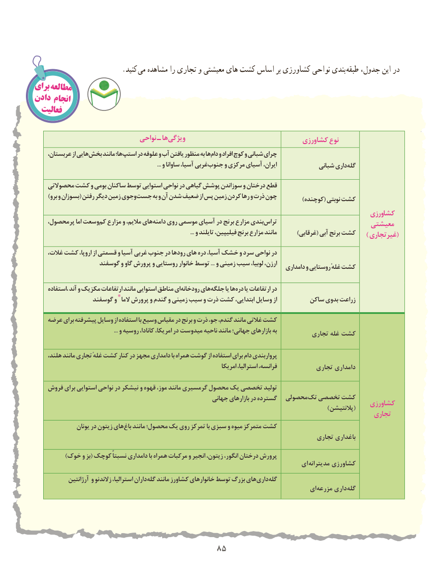

# PDF page 93

.کنید  می مشاهده را تجاری و معیشتی های کشت اساس بر کشاورزی نواحی بندی طبقه جدول، این در
برایمطالعه
دادن انجام
  فعالیت

                               نواحی ـ هاویژگی‌                                    کشاورزی نوع
     عربستان، از هاییبخش‌     مانند ها؛استپ‌    در علوفه و آب یافتن منظور به هادام‌  و افراد کوچ و شبانی چرای
         ...‌و ساوانا آسیا، غربیجنوب و مرکزی آسیای ایران،             شبانی داریگله‌

    محصوالتی کشت و بومی ساکنان توسط استوایی نواحی در گیاهی پوشش سوزاندن و درختان قطع
) برو و بسوزان( رفتن دیگر زمین وجویجست به و آن شدن ضعیف از پس زمین کردن رها و ذرت چون                                                                                                           )کوچنده( نوبتی کشت
                                                                                              کشاورزی
    پرمحصول، اما وسعتکم‌  مزارع و مالیم، هایدامنه‌    روی  موسمی آسیای در برنج مزارع بندیتراس‌                           معیشتی
                                                                                                                 ... و تایلند فیلیپین، برنج مزارع مانند        )غرقابی( آبی برنج کشت    ) غیرتجاری(
    غالت، کشت اروپا، از قسمتی و آسیا غربی جنوب در رودها های دره آسیا، خشک و سرد نواحی در
                   گوسفند و گاو پرورش و روستایی خانوار توسط ... و زمینی سیب لوبیا، ارزن،                                                                                         دامداری و روستایی غلهٔ کشت

     ،استفاده آند و مکزیک ارتفاعات مانند استوایی مناطق ای رودخانه های جلگه یا ها دره یا ارتفاعات در
                 گوسفند و ٭ الما پرورش و گندم و زمینی سیب و ذرت کشت ابتدایی، وسایل از         ساکن بدوی زراعت

    عرضه برای پیشرفته وسایل از استفاده با وسیع مقیاس در برنج و ذرت جو، گندم، مانند غالتی کشت
                                                         ... و روسیه کانادا، امریکا، در میدوست ناحیه مانند جهانی؛ بازارهای به                                                                                   تجاری غله کشت

     هلند، مانند تجاری غلهٔ کشت کنار در مجهز دامداری با همراه گوشت از استفاده برای دام پرواربندی
                                                                          امریکا استرالیا، فرانسه،            تجاری دامداری

    فروش برای استوایی نواحی در نیشکر و قهوه موز، مانند گرمسیری محصول یک تخصصی تولید
                                                       جهانی بازارهای در گسترده  محصولیتک‌  تخصصی کشت                                                                                            کشاورزی                                                                                                                      )پالنتیشن(                                                                                                 تجاری
                یونان در زیتون هایباغ‌   مانند محصول؛ یک روی تمرکز با سبزی و میوه متمرکز کشت
                                                                                    تجاری باغداری
            )خوک و بز( کوچک نسبتاً دامداری با همراه مرکبات و انجیر زیتون، انگور، درختان پرورش
                                                                                 ای  مدیترانه کشاورزی
             آرژانتین و زالندنو استرالیا، دارانگله‌   مانند کشاورز خانوارهای توسط بزرگ هایداری‌   گله‌
                                                                                   ای ‌مزرعه داری‌گله

                                    8585

