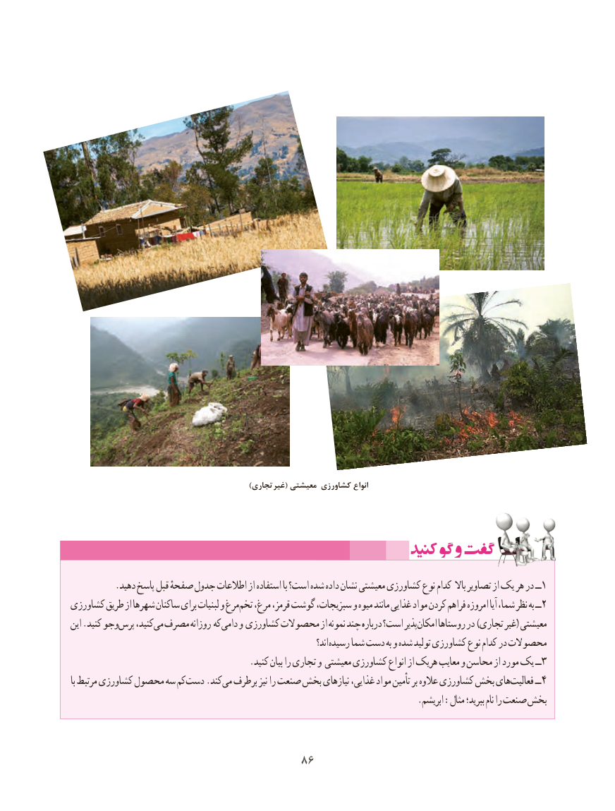

# PDF page 94

)تجاری غیر( معیشتی کشاورزی انواع

          .دهید پاسخ قبل صفحهٔ جدول اطالعات از استفاده با است؟ شده داده نشان معیشتی کشاورزی نوع کدام باال تصاویر از یک هر در ــ1
کشاورزی طریق از شهرها ساکنان برای لبنیات و مرغتخم۲‌   مرغ، قرمز، گوشت سبزیجات، و میوه مانند غذایی مواد کردن فراهم امروزه آیا شما، نظر به ــ
این .کنید وجوپرس‌    کنید،می‌ مصرف روزانه که دامی و کشاورزی محصوالت از نمونه چند دربارهٔ است؟ پذیرامکان‌     روستاها در )تجاری غیر( معیشتی
                                                                               اند؟ رسیده شما دست به و شده تولید کشاورزی نوع کدام در محصوالت
                                       .کنید بیان را تجاری و معیشتی کشاورزی انواع از هریک معایب و محاسن از مورد یک ــ۳
با مرتبط کشاورزی محصول سه کمدست‌    .کند می طرف بر نیز را صنعت بخش نیازهای غذایی، مواد تأمین بر عالوه کشاورزی بخش هایفعالیت۴‌       ــ
                                                                            .ابریشم :مثال ببرید؛ نام را صنعت بخش

                                  8686

