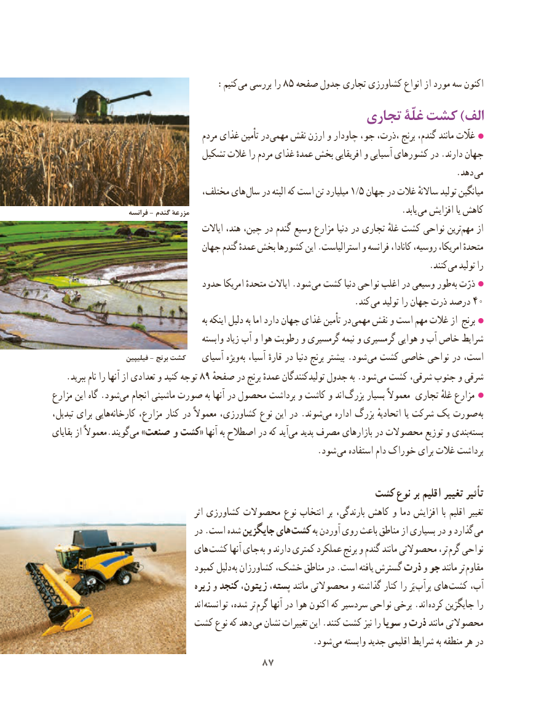

# PDF page 95

:کنیم می بررسی را ٥٨ صفحه جدول تجاری کشاورزی انواع از مورد سه اکنون
                                            تجاری غلّۀ کشت ) الف
                                       مردم غذای تأمین در مهمی نقش ارزن و چاودار جو، ،ذرت، برنج گندم، مانند غااّلّت
                                تشکیل غالت را مردم غذای عمدهٔ بخش افریقایی و آسیایی کشورهای در .دارند جهان
                                                                                              .دهد می
                                 مختلف، های سال در البته که است تن میلیارد 1/5 جهان در غالت ساالنهٔ تولید میانگین
                        فرانسه - گندم مزرعهٔ                        . یابد می افزایش یا کاهش
                                           ایاالت هند، چین، در گندم وسیع مزارع دنیا در تجاری غلهٔ کشت نواحی ترینمهم‌    از
                                جهان گندم عمدهٔ بخش کشورها این .استرالیاست و فرانسه کانادا، روسیه، امریکا، متحدهٔ
                                     . کنند می تولید را
                               حدود امریکا متحدهٔ ایاالت .شود  می کشت دنیا نواحی اغلب در وسیعی طور  به ذرّت
                                                                      .کند  می تولید را جهان ذرت درصد 40
                                                        به اینکه دلیل به اما دارد جهان غذای تأمین در مهمی نقش و است مهم غالت از برنج
                                          وابسته زیاد آب و هوا رطوبت و گرمسیری نیمه و گرمسیری هوایی و آب خاص شرایط
                       فیلیپین - برنج کشت                                   آسیای ویژه  به آسیا، قارهٔ در دنیا برنج بیشتر .شود می کشت خاصی نواحی در است،
   .ببرید نام را آنها از تعدادی و کنید توجه 89 صفحهٔشوددر برنج عمدهٔ تولیدکنندگان جدول به .        می کشت شرقی، جنوب و شرقی
مزارع این گاه .شود ‌می انجام ماشینی صورت به آنها در محصول برداشت و کاشت و اند بزرگ بسیار معموالً تجاری غلهٔ مزارع
،هاییتبدیل برای        ‌کارخانه مزارع، کنار در معموالً کشاورزی، نوع این در .شوندمی‌   اداره بزرگ اتحادیهٔ یا شرکت یک صورت به
بقایای از معموالً.گویند ‌می »صنعت و کشت« آنها به اصطالح در که آیدمی‌   پدید مصرف بازارهای در محصوالت توزیع و بندی‌بسته
                                                              .شود  می استفاده دام خوراک برای غالت برداشت

                                                  کشت نوع بر اقلیم تغییر تأثیر
                                                 اثر کشاورزی محصوالت نوع انتخاب بر بارندگی، کاهش و دما افزایش  با اقلیم تغییر
                                  در .است شده جایگزین های کشت به آوردن روی باعث مناطق از بسیاری در و گذارد می
                              های  کشت آنها جای به و دارند کمتری عملکرد برنج و گندم مانند محصوالتی تر، گرم نواحی
                                   کمبود دلیل به کشاورزان خشک، مناطق در .است یافته گسترش ذرت و جو مانند تر مقاوم
                                   زیره و کنجد زیتون، پسته، مانند محصوالتی و گذاشته کنار را بَر پرآب های کشت آب،
                                               اند توانسته شده، تر گرم آنها در هوا اکنون که سردسیر نواحی برخی .اند کرده جایگزین را
                       کشت نوع که دهد می نشان تغییرات این .کنند کشت نیز را سویا و ذرت مانند محصوالتی
                        . شود می وابسته جدید اقلیمی شرایط به منطقه هر در
                                  8787

