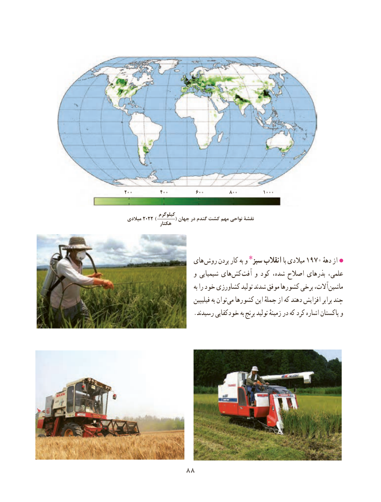

# PDF page 96

200          400          600         800         1000

           ______کیلوگرم میالدی 2022 )           ( جهان در گندم کشت مهم نواحی نقشۀ               هکتار

                     های روش بردن کار به و سبز٭ انقالب با میالدی 1970 ازدهه
                       و شیمیایی های ‌کش ‌آفت و کود شده، اصالح بذرهای علمی،
                                    به را خود کشاورزی تولید شدند موفق کشورها برخی آالت، ماشین
                              فیلیپین به توان‌می کشورها این جملهٔ از که دهند افزایش برابر چند
                       .رسیدند خودکفایی به برنج تولید زمینهٔ در که کرد اشاره پاکستان و

              8888

