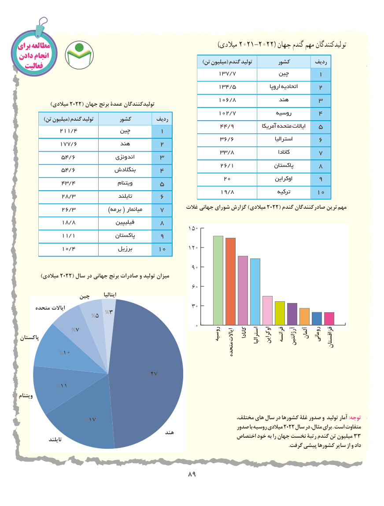

# PDF page 97

برای مطالعه                                                                                )میالدی 2021-2022( جهان گندم مهم تولیدکنندگان
دادن انجام                                                                                     )تن میلیون( گندم تولید        کشور        ردیف  فعالیت
                                                       137/7             چین       1
                                                       134/5                اروپا اتحادیه     2
                                                       106/8             هند       3      )2022(میالدی     جهان برنج عمدۀ تولیدکنندگان
                                                       102/7             روسیه      4            )تن میلیون( گندم تولید        کشور        ردیف
                                                        44/9           آمریکا متحده ایاالت   5            211/4             چین       1
                                                        36/6                  استرالیا      6            177/6             هند       2
                                                        33/8                      کانادا       7            54/6              اندونزی      3
                                                        26/1             کستان پا      8            54/6             بنگالدش      4
                                                      20                 اوکراین      9            43/4                 ویتنام      5
                                                        19/8                 ترکیه      10            28/3                  تایلند      6
                                                        غالت جهانی شورای گزارش )میالدی 2022( گندم صادرکنندگان ترین  مهم            26/3              )برمه ( میانمار    7
            18/8               فیلیپین      8
                                                 150
            11/1              پاکستان      9
            10/4               برزیل      10      120

                                                  90
           )میالدی 2022( سال در جهانی برنج صادرات و تولید میزان
                                                  60
                  چین        ایتالیا
      متحده ایاالت                                     30                       %3
                   %5
                                                   0
 پاکستان              %7                                                         روسیه ایاالت  کانادا استرالیا اوکراین فرانسه آرژانتین آلمان رومانی قزاقستان
           %10                                                                   متحده

                                  %47

          %11
 ویتنام

                  %17                                                 مختلف، های سال در کشورها غلۀ صدور و تولید آمار :توجه
                                                                       صدور با روسیه میالدی 2022 سال در مثال، برای . است متفاوت                                                  هند                                                                    اختصاص خود به را جهان نخست رتبۀ گندم تن میلیون 33              تایلند                                                                                                                                                                                                            .گرفت پیشی کشورها سایر از و داد

                                         89898989

