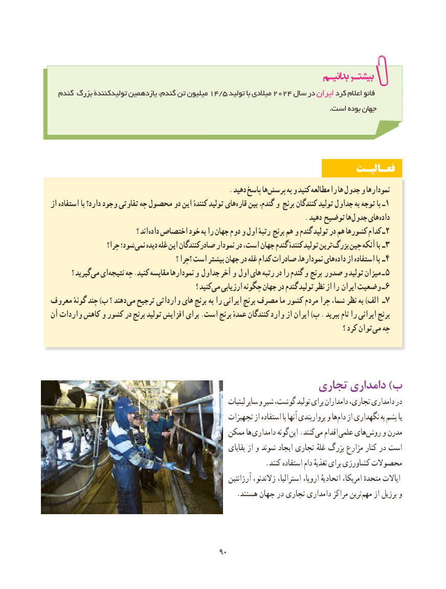

# PDF page 98

گندم بزرگ تولیدکنندۀ یازدهمین گندم، تن میلیون 14/5 تولید با میالدی 2024 سال در ایران کرد اعالم فائو
                                                                                                                        .است بوده جهان

                                                               فعـالیـت
                                                      . دهید پاسخ ها پرسش به و کنید مطالعه را ها جدول و نمودارها
از استفاده با دارد؟ وجود تفاوتی چه محصول دو این کنندهٔ تولید های قاره بین گندم، و برنج کنندگان تولید جداول به توجه با ـ 1
                                                                             . دهید توضیح ها جدول های داده
                                ؟ اند داده۲اختصاص خود به را جهان دوم و اول رتبهٔ برنج هم و گندم تولید در هم کشورها کدام ـ
                  چرا؟ شود؛ نمی دیده غله این صادرکنندگان نمودار در است، جهان گندم کنندهٔ تولید ترین بزرگ۳چین آنکه با ـ
                                               ؟ ؟چرا است بیشتر جهان در غله کدام صادرات نمودارها، های داده۴از استفاده با ـ
        ؟ گیرید می ای نتیجه چه .کنید مقایسه نمودارها و جداول آخر و اول های رتبه در را گندم و برنج صدور و تولید میزان ـ ۵
                                                       ؟ کنید می ارزیابی چگونه جهان در گندم تولید نظر از را ایران وضعیت ـ ۶
معروف گونهٔ چند )ب ؟ دهند می۷ترجیح وارداتی های برنج به را ایرانی برنج مصرف ما کشور مردم چرا شما، نظر به )الف ـ
آن واردات کاهش و کشور در برنج تولید افزایش برای .است برنج عمدهٔ کنندگان وارد از ایران )پ . ببرید نام را ایرانی برنج
                                                                                                              ؟ کرد توان می چه

                                             تجاری دامداری )ب
                                                                لبنیات سایر و شیر گوشت، تولید برای دامداران تجاری، دامداری در
                                                  تجهیزات از استفاده با آنها پرواربندی و هادام‌   از نگهداری به پشم یا
                                            ممکن ها دامداری گونه این .کنندمی‌   اقدام علمی هایروش‌    و مدرن
                                                                بقایای از و شوند ایجاد تجاری غلهٔ بزرگ مزارع کنار در است
                                                            .کنند استفاده دام تغذیهٔ برای کشاورزی محصوالت
                                                               آرژانتین زالندنو، استرالیا، اروپا، اتحادیهٔ امریکا، متحدهٔ ایاالت
   .‌هستند جهان در تجاری دامداری مراکز ترینمهم از برزیل و

                                           9090

