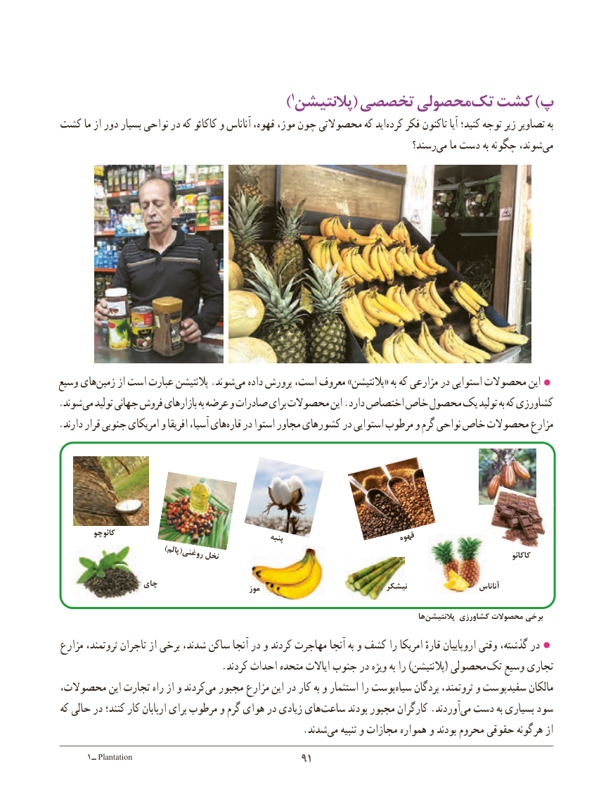

# PDF page 99

)1پالنتیشن( تخصصی محصولیتک‌  کشت )پ
کشت ما از دور بسیار نواحی در که کاکائو و آناناس قهوه، موز، چون محصوالتی که ایدکرده‌   فکر تاکنون آیا کنید؛ توجه زیر تصاویر به
                                                                          رسند؟‌می ما دست به چگونه شوند،می‌

وسیع هایزمین‌     از است عبارت پالنتیشن .شوندمی‌   داده پرورش است، معروف »پالنتیشن« به که مزارعی در استوایی محصوالت این
.شوند می تولید جهانی فروش بازارهای به عرضه و صادرات برای محصوالت این .دارد اختصاص خاص محصول یک تولید به که کشاورزی
.‌دارند قرار جنوبی امریکای و افریقا آسیا، هایقاره در استوا مجاور کشورهای در استوایی مرطوب و گرم نواحی خاص محصوالت مزارع

          کائوچو                                                    پنبه                        قهوه
                   )پالم(روغنینخل                                                                                              کاکائو

                  چای                                                   موز                              نیشکر                     آناناس

                                                                                                         ها‌پالنتیشن کشاورزی محصوالت برخی
مزارع ثروتمند، تاجران از برخی شدند، ساکن آنجا در و کردند مهاجرت آنجا به و کشف را امریکا قارهٔ اروپاییان وقتی گذشته، در
                                 .کردند احداث متحده ایاالت جنوب در ویژه به را )پالنتیشن( محصولی تک وسیع تجاری
محصوالت، این تجارت راه از و کردندمی‌  مجبور مزارع این در کار به و استثمار را پوستسیاه‌    بردگان ثروتمند، و سفیدپوست مالکان
که حالی در کنند؛ کار اربابان برای مرطوب و گرم هوای در زیادی هایساعت‌      بودند مجبور کارگران .آوردند‌می دست به بسیاری سود
                  .‌شدندمی تنبیه و مجازات همواره و بودند محروم حقوقی گونه  هر از
      1ــ Plantation                                9191

