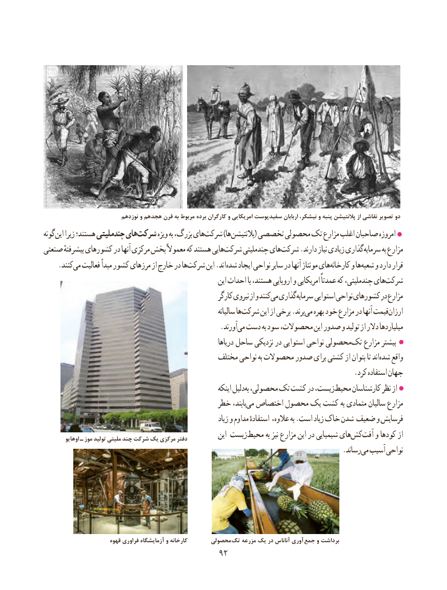

# PDF page 100

نوزدهم و هجدهم قرن به مربوط برده کارگران و امریکایی سفیدپوست اربابان نیشکر، و پنبه پالنتیشن از نقاشی تصویر دو
گونه این زیرا هستند؛ چندملیتی هایشرکت‌       ویژه به بزرگ، هایشرکت‌       )ها پالنتیشن( تخصصی محصولی تک مزارع اغلب صاحبان امروزه
صنعتی پیشرفتهٔ کشورهای در آنها مرکزی بخش معموالً که هستند هاییشرکت‌     چندملیتی هایشرکت‌     .دارند نیاز زیادی گذاریسرمایه‌       به مزارع
    .کنندمی‌  فعالیت مبدأ کشور مرزهای از خارج در هاشرکت‌      این .اند شده ایجاد نواحی سایر در آنها مونتاژ هایکارخانه‌     و هاشعبه‌   و دارد قرار
                                                            این احداث با هستند، اروپایی و امریکایی عمدتاً که چندملیتی، هایشرکت‌
                                                          کارگر نیروی از و کنند می گذاریسرمایه‌     استوایی نواحی کشورهای در مزارع
                                                                       سالیانه هاشرکت‌      این از برخی .برند می بهره خود مزارع در آنها قیمتارزان‌
                  .‌آورندمی دست به سود محصوالت، این صدور و تولید از دالر میلیاردها
                                                                  دریاها ساحل نزدیکی در استوایی نواحی محصولی تک مزارع بیشتر
                                           مختلف نواحی به محصوالت صدور برای کشتی از بتوان تا اندشده‌   واقع
                                                                                       .کرد استفاده جهان
                                                                                             ‌اینکه دلیل به محصولی، تک کشت در زیست،محیط‌     کارشناسان نظر از
                                        خطر یابند،می‌  اختصاص محصول یک کشت به متمادی سالیان مزارع
                                                                   زیاد و مداوم استفادهٔ عالوه، به .است زیاد خاک شدن ضعیف و فرسایش
         اوهایو ـ موز تولید ملیتی چند شرکت یک مرکزی دفتر           این زیستمحیط‌       به نیز مزارع این در شیمیایی هایکش‌  آفت‌   و کودها از
                             .‌رساندمی آسیب نواحی

                        قهوه فراوری آزمایشگاه و کارخانه       محصولی تک مزرعه یک در آناناس آوری جمع و برداشت
                                       9292

