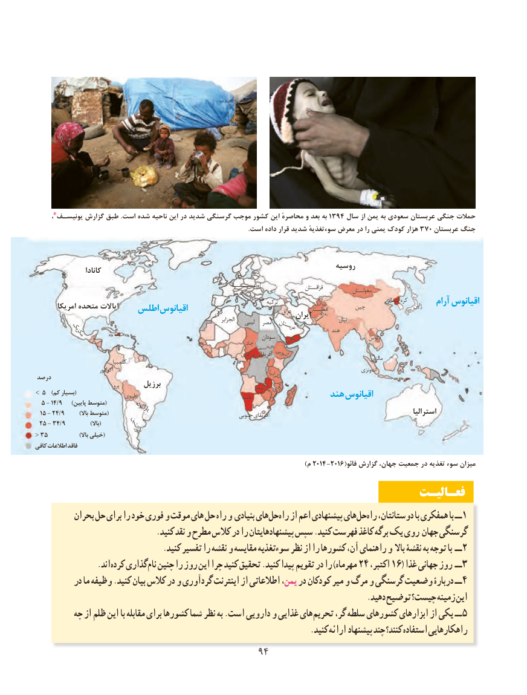

# PDF page 102

،یونیسـف٭ گزارش طبق .است شده ناحیه این در شدید گرسنگی موجب کشور این محاصرهٔ و بعد به 1394 سال از یمن به سعودی عربستان جنگی حمالت
     .370است داده قرار شدید سوءتغذیهٔ معرض در را یمنی کودک هزار    عربستان جنگ

                                                                            روسیه                   کانادا
                                                                                                        اروپــــــــــا                   قزاقستان                                                                                                                                  مغولستان
                                                                                                                            شمالی کره                                                                                                                                                                          ژاپن    آرام اقیانوس                                                                                            چین       امریکا متحده ایاالت   اطلس اقیانوس                                  ترکیه عراق        افغانستان                                            مغرب                       ایران                                                                                                  الجزایر    لیبی  مصر             پاکستان                                                                                     عربستان            هندنپال          مکزیک                                                                                    سودان    یمن                           الئوس                                                                                 چاد
                                                                     مرکزی آفریقای اتیوپی                                                                                                                                             مالزی                                  کلمبیا
                                اکوادور                                                                               تانزانیا                                   اندونزی درصد
                                     پرو       برزیل                                                    زامبیا> 5 )(کم بسیار                                       بولیوی                                                           نامبیا      موزامبیک         هند اقیانوس  ۵ - ۱۴/ ۹ )(پایین متوسط                                                                                             ماداگاسکار                                           پاراگوئه  ۱۵ - ۲۴/۹ )(باال متوسط                                               جنوبی آفریقای                                                 استرالیا
 ۲۵ - ۳۴/۹    )(باال                آرژانتین
<35  )(باال خیلی
کافی اطالعات فاقد
                                                                                                     )م ۲۰۱۴ -۲۰۱۶(فائو گزارش جهان، جمعیت در تغذیه سوء میزان
                                                                   فعـالیـت
          بحران حل برای را خود فوری و موقت های حل راه و بنیادی هایحل‌  راه‌  از اعم پیشنهادی هایحل‌  راه‌  دوستانتان، با همفکری با ــ 1
                               .کنید نقد و مطرح کالس در را پیشنهادهایتان سپس .کنید فهرست کاغذ برگه یک روی جهان گرسنگی
                                 .کنید تفسیر را نقشه و مقایسه سوءتغذیه نظر از را کشورها آن، راهنمای و باال نقشۀ به توجه با ــ ۲
                .اند کرده گذاری نام چنین را روز این چرا کنید تحقیق .کنید پیدا تقویم در را )مهرماه 24 ،اکتبر 16( غذا جهانی روز ــ 3
          در ما وظیفه .کنید بیان کالس در و گردآوری اینترنت از اطالعاتی یمن، در کودکان میر و مرگ و گرسنگی وضعیت دربارۀ ــ 4
                                                                                     .دهید توضیح چیست؟ زمینه این
         چه از ظلم این با مقابله برای کشورها شما نظر به .است دارویی و غذایی های تحریم گر، سلطه کشورهای ابزارهای از یکی ــ 5
                                                                      .کنید ارائه پیشنهاد چند کنند؟ استفاده راهکارهایی
                                         9494

