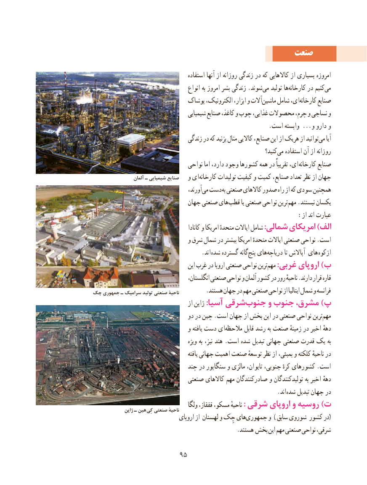

# PDF page 103

صنعت
                                        استفاده آنها از روزانه زندگی در که کاالهایی از بسیاری امروزه
                                       انواع به امروز بشر زندگی .شوندمی‌   تولید هاکارخانه‌      در کنیممی‌
                            پوشاک الکترونیک، ابزار، و آالتماشین‌    شامل ای،کارخانه‌      صنایع
                                     شیمیایی صنایع کاغذ، و چوب غذایی، محصوالت چرم، و نساجی و
                                                            .است وابسته ...  و دارو و
                                 زندگی در که بزنید مثال کاالیی صنایع، این از هریک از توانیدمی‌    آیا
                                                                        کنید؟می‌   استفاده آن از روزانه
                                نواحی اما دارد، وجود کشورها همه در تقریباً ای، کارخانه صنایع
                   آلمان ـ شیمیایی صنایع   و ای‌کارخانه تولیدات کیفیت و کمیت صنایع، تعداد نظر از جهان
                                         آورند،می‌ دست به صنعتی کاالهای صدور راه از که سودی همچنین
                              جهان صنعتی هایقطب‌       یا صنعتی نواحی ترینمهم‌   .نیستند یکسان
                                                        :از اند عبارت
                                               کانادا و امریکا متحدهٔ ایاالت شامل :شمالی امریکای )الف
                                 و شرق شمال در بیشتر امریکا متحدهٔ ایاالت صنعتی نواحی .است
                    . اند شده گسترده گانهپنج‌  هایدریاچه‌          تا آپاالش های ازکوه
                                        این غرب در اروپا صنعتی نواحی ترینمهم‌    :غربی اروپای )ب
                                       انگلستان، صنعتی نواحی و آلمان کشور در رور ناحیهٔ .دارند قرار قاره
چک جمهوری ـ سرامیک تولید صنعتی ناحیهٔ         .هستند جهان در مهم صنعتی نواحی از ایتالیا شمال و فرانسه
                                        از ژاپن :آسیا شرقیجنوب‌     و جنوب مشرق، )پ
                                 دو در چین .است جهان از بخش این در صنعتی نواحی ترینمهم‌
                                 و یافته دست ای‌مالحظه قابل رشد به صنعت زمینهٔ در اخیر دههٔ
                                          ویژه به نیز، هند .است شده تبدیل جهانی صنعتی قدرت یک به
                                                 یافته جهانی اهمیت صنعت توسعهٔ نظر از بمبئی، و کلکته ناحیهٔ در
                              چند در سنگاپور و مالزی تایوان، جنوبی، کرهٔ کشورهای .است
                              صنعتی کاالهای مهم صادرکنندگان و تولیدکنندگان به اخیر دههٔ
                                                               .اند ‌شده تبدیل جهان در
                                       ولگا قفقاز، مسکو، ناحیهٔ : شرقی اروپای و روسیه )ت               ژاپن ـ هین کِی صنعتی ناحیهٔ
                                  اروپای از لهستان و چِک هایجمهوری‌(و ) سابق شوروی کشور در
                                                 .هستند بخش این مهم صنعتی نواحی شرقی،

                      9595

