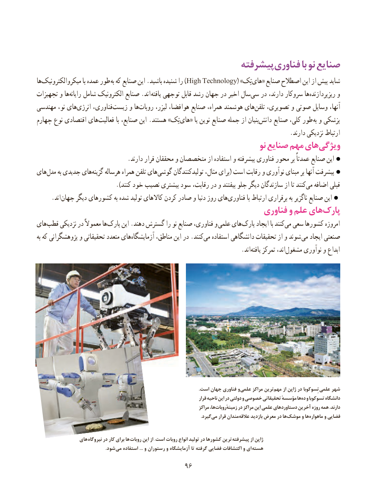

# PDF page 104

پیشرفتهفناوری‌         با نو صنایع
ها‌میکروالکترونیک با عمده طور )به که صنایع این .باشید شنیده را High Technology( »تِک‌های« صنایع اصطالح این از پیش شاید
تجهیزات و هارایانه‌    شامل الکترونیک صنایع .اند یافته توجهی قابل رشد جهان در اخیر سالسی‌   در دارند، سروکار هاریزپردازنده‌         و
مهندسی نو، های ‌انرژی فناوری،زیست‌     و هاروبات‌      لیزر، هوافضا، صنایع همراه، هوشمند هایتلفن‌   تصویری، و صوتی وسایل آنها،
چهارم نوع اقتصادی های‌فعالیت با صنایع، این .هستند »تِک‌های« یا نوین صنایع جمله از بنیاندانش‌     صنایع کلی، طور  به و پزشکی
                                                                                    .دارند نزدیکی ارتباط
                                                                    نو صنایع مهم هایویژگی‌
                              .دارند قرار محققان و متخصصان از استفاده و پیشرفته فناوری محور بر عمدتاً صنایع این
های‌مدل به جدیدی هایگزینه‌    هرساله همراه تلفن هایگوشی‌      تولیدکنندگان مثال، برای( است رقابت و نوآوری مبنای بر آنها پیشرفت
                               .)کنند خود نصیب بیشتری سود رقابت، در و بیفتند جلو دیگر سازندگان از تا کنندمی‌  اضافه قبلی
   . اند جهان دیگر کشورهای به شده تولید کاالهای کردن صادر و دنیا روز هایفناوری‌           با ارتباط برقراری به ناگزیر صنایع این
                                                         فناوری و علم هایپارک‌
های‌قطب نزدیکی در معموالً هاپارک‌     این .دهند گسترش را نو صنایع فناوری، و  علمی هایپارک‌     ایجاد با کنندمی‌  سعی کشورها امروزه
به که پژوهشگرانی و تحقیقاتی متعدد های‌آزمایشگاه مناطق، این در .کنندمی‌   استفاده دانشگاهی تحقیقات از و شوند  می ایجاد صنعتی
                                     .‌اندیافته تمرکز اند،مشغول‌      نوآوری و ابداع

                                                                                                                                          .است جهان فناوری و علمی مراکز ترینمهم‌     از ژاپن در تِسوکوبا علمی شهر
                                                                                      قرار ناحیه این در دولتی و خصوصی تحقیقاتی مؤسسهٔ هاده‌  و تسوکوبا دانشگاه
                                                                              مراکز ها،زمینهٔروبات‌         در مراکز این علمی دستاوردهای آخرین روزه همه .دارند
                            .‌گیردمی قرار مندانعالقه‌     بازدید معرض در هاموشک‌      و هاماهواره‌      و فضایی

                های  نیروگاه در کار برای ها روبات این از .است روبات انواع تولید در کشورها ترین پیشرفته از ژاپن
            . شود می استفاده ... و رستوران و آزمایشگاه تا گرفته فضایی اکتشافات و ای هسته
                                       9696

