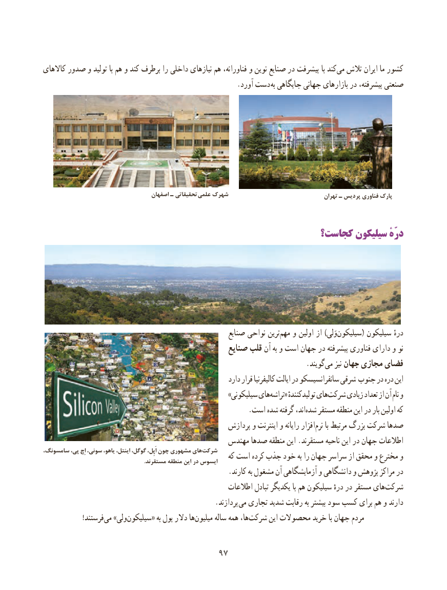

# PDF page 105

کاالهای صدور و تولید با هم و کند برطرف را داخلی نیازهای هم فناورانه، و نوین صنایع در پیشرفت با کندمی‌  تالش ایران ما کشور
           . آورد دست به جایگاهی جهانی بازارهای در پیشرفته، صنعتی

                                     اصفهان ـ تحقیقاتی علمی شهرک                                   تهران ـ پردیس فناوری پارک

                                                  کجاست؟ سیلیکون درّهٔ

                                                        صنایع نواحی ترینمهم‌   و اولین از )وَلی‌سیلیکون( سیلیکون درهٔ
                                                صنایع قلب آن به و است جهان در پیشرفته فناوری دارای و نو
                         .‌گویندمی نیز جهان مجازی فضای
                                                             دارد قرار کالیفرنیا ایالت در سانفرانسیسکو شرقی جنوب‌     در دره این
                                                             »سیلیکونی هایتراشه‌    « تولیدکنندهٔ هایشرکت‌     زیادی تعداد از آن نام و
       .‌است شده گرفته اند،شده مستقر منطقه این در بار اولین‌    که
                                                  پردازش و اینترنت و رایانه افزار‌نرم با مرتبط بزرگ شرکت صدها
                                            مهندس صدها منطقه این .مستقرند ناحیه این در جهان اطالعات
سامسونگ، پی، اِچ سونی، یاهو، اینتل، گوگل، اَپِل، چون مشهوری های‌شرکت                                                          که است کرده جذب خود به را جهان سراسر از محقق و مخترع و                                                                        .مستقرند منطقه این در ایسوس
                                                    .کارند به مشغول آن آزمایشگاهی و دانشگاهی و پژوهش مراکز در
                                                     اطالعات تبادل یکدیگر با هم سیلیکون‌          درهٔ در مستقر های‌شرکت
                                                .پردازند می تجاری شدید رقابت به بیشتر سود کسب برای هم و دارند
   !‌فرستندمی »ولی‌سیلیکون« به پول دالر هامیلیون‌      ساله همه‌    ها،‌شرکت این محصوالت خرید با جهان مردم

                                     9797

