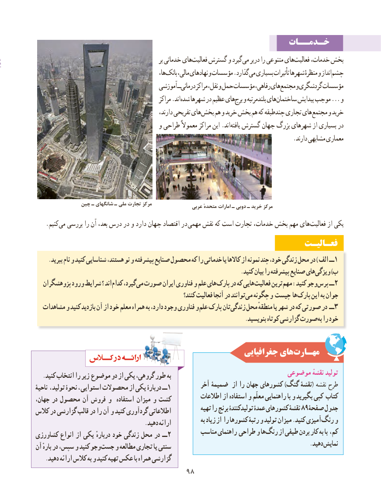

# PDF page 106

خـدمــات
                                                             بر خدماتی هایفعالیت‌    گسترش و گیرد می بر در را متنوعی هایفعالیت‌     خدمات، بخش
                                                      ها،بانک‌    مالی، نهادهای و مؤسسات .گذاردمی‌  بسیاری تأثیرات شهرها منظرهٔ و اندازچشم‌
                                         آموزشی ــ درمانی مراکز نقل، و حمل مؤسسات رفاهی، هایمجتمع‌    و گردشگری مؤسسات
                                                   مراکز .اند شده شهرها در عظیم هایبرج‌  و بلندمرتبه هایساختمان‌       پیدایش موجب ... و
                                                     دارند، تفریحی های بخش هم و خرید  بخش هم که چندطبقه تجاری های مجتمع و خرید
                                         و طراحی معموالً مراکز این .اند یافته گسترش جهان بزرگ شهرهای از بسیاری در
                                                                                    .دارند مشابهی معماری

               چین ـ شانگهای ـ ملی تجارت مرکز                                                            عربی متحدهٔ امارات ـ دوبی ـ خرید مرکز
   .کنیم‌می بررسی را آن بعد، درس در و دارد جهان اقتصاد در مهمی نقش که است تجارت خدمات، بخش مهم هایفعالیت‌      از یکی
                                                                 فعـالیـت
     .ببرید نام و کنید شناسایی هستند، نو و پیشرفته صنایع محصول که را خدماتی یا کاالها از نمونه چند خود، زندگی محل در ) الف ــ1
                                                                        .کنید بیان را پیشرفته صنایع های ویژگی )ب
  پژوهشگران ورود شرایط ؟ اند کدام گیرد، می صورت ایران فناوری و علم های پارک در که هایی فعالیت ترین مهم :کنید جو و پرس ــ2
                                                              کنند؟ فعالیت آنجا در توانند می چگونه و چیست ها پارک این به جوان
  مشاهدات و کنید بازدید آن از خود معلم همراه به دارد، وجود فناوری و علم پارک تان زندگی محل منطقهٔ یا شهر در که صورتی در ــ 3
                                                                          .بنویسید کوتاه گزارشی صورت به را خود

                                                       جغرافیایی هایمهـارت‌
                                                                 موضوعی نقشهٔ تولید   .کنید انتخاب را زیر موضوع دو از یکی گروهی، طور به
                                                       آخر ضمیمۀ از را جهان کشورهای )گنگ نقشۀ( نقشه طرحناحیۀ ، تولید نحوۀ ، استوایی محصوالت از یکی دربارۀ ــ 1
                                                       اطالعات از استفاده و معلّم راهنمایی با و بگیرید کپی کتاب،کشتجهان در محصول آن فروش و  استفاده میزان و
                                                              تهیه را برنج تولیدکنندۀ عمدۀ کشورهای نقشۀ 89صفحۀ جدولکالس در گزارشی قالب در را آن و کنید گردآوری اطالعاتی
                                                                         به زیاد از را کشورها رتبۀ و تولید میزان .کنید آمیزیرنگ‌   و                                       .دهید ارائه
                                                   مناسب راهنمای طراحی و هارنگ‌    از طیفی بردن کار به با کم،کشاورزی انواع از یکی دربارهٔ خود زندگی محل در ــ 2
                                                                                                 .دهید نمایشآن بارهٔ در سپس، و کنید وجو جست و مطالعه تجاری یا سنتی
   .دهید ارائه کالس به و کنید تهیه عکس با همراه گزارشی
                                    9898

