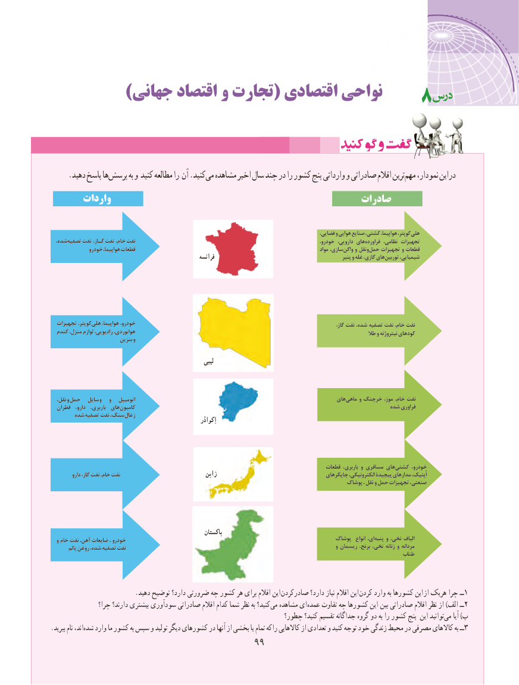

# PDF page 107

)جهانی اقتصاد و تجارت( اقتصادی نواحی                                 8

     ..دهیددهید پاسخپاسخ هاهاپرسشپرسش‌‌       بهبه وو کنیدکنید مطالعهمطالعه رارا آنآن ..کنیدکنیدمیمی‌‌  مشاهدهمشاهده اخیراخیر سالسال چندچند دردر رارا کشورکشور پنجپنج وارداتیوارداتی وو صادراتیصادراتی اقالماقالم ترینترینمهممهم‌‌   نمودار،نمودار، ایناین  دردر
       واردات                                                  صادرات

                     ،کوپتر،فضایی و هوایی صنایع کشتی، هواپیما،    هلی‌
  ،شدهتصفیه‌    نفت گـاز، نفت خام، نفت                                                                          خودرو، دارویی، های فراورده نظامی، تجهیزات
              خودرو هواپیما، قطعات                                                                                    مواد سازی، واگن و نقل و‌ حمل تجهیزات و قطعات
                                                          فرانسه                                                         پنیر و غله گازی، هایتوربین‌     شیمیایی،

  تجهیزات کوپتر، هلی هواپیما، خودرو،          ،نفتگاز نفت شده، تصفیه نفت خام،
  گندم منزل، لوازم رادیویی، هوانوردی،                                                                                               طال و نیتروژنه کودهای
                            بنزین و

                                                               لیبی

   ،نقل و‌ حمل  وسایل   و   اتومبیل                                                                   هایماهی‌     و خرچنگ موز، خام، نفت
  قطران  دارو،  باربری،  هایکامیون‌                                                                                 شده فراوری
       شده ‌تصفیه نفت سنگ،زغال‌                                                                            اِکوادُر

                                                                                             قطعات باربری، و مسافری هایکشتی‌      خودرو،
          دارو گاز، نفت خام، نفت                               ژاپن                                       چاپگرهای الکترونیکی، پیچیدة مدارهای اُپتیک،
                                                                                              پوشاک ، نقل و حمل تجهیزات صنعتی،

                                                            پاکستان
  و خام نفت آهن، ضایعات ، خودرو                                                                  پوشاک  انواع ای، پنبه و نخی، الیاف
        پالم روغن شده، تصفیه نفت                                                                                   و ریسمان برنج، نخی، زنانه و مردانه
                                                                                                                      طناب

 . دهید توضیح دارد؟ ضرورتی چه کشور هر برای اقالم این صادرکردن دارد؟ نیاز اقالم این کردن وارد به کشورها این از هریک چرا ــ1
                چرا؟ دارند؟ بیشتری سودآوری صادراتی اقالم کدام شما نظر به کنید؟می‌  مشاهده ای‌عمده تفاوت چه کشورها این  بین صادراتی اقالم نظر از )الف ــ2
                                                                چطور؟ کنید؟ تقسیم جداگانه گروه دو به را کشور پنج این توانیدمی‌    آیا )ب
.‌ببرید نام اند،شده وارد ما کشور به سپس و تولید دیگر کشورهای در آنها از بخشی یا تمام راکه کاالهایی از تعدادی و کنید توجه خود زندگی محیط در مصرفی کاالهای به ــ3
                                       9999

