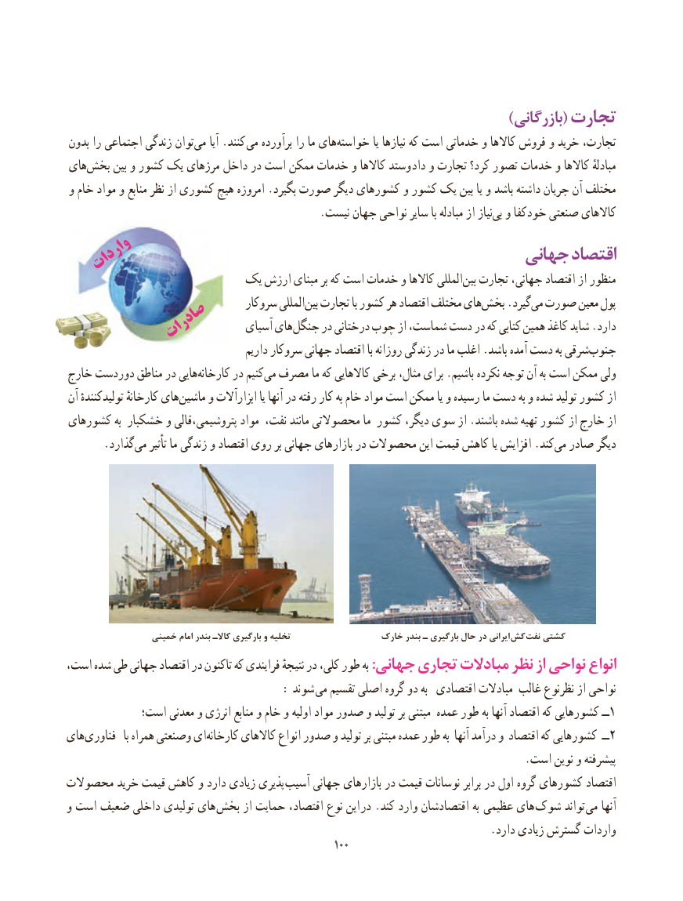

# PDF page 108

)بازرگانی( تجارت
بدون را اجتماعی زندگی توانمی‌    آیا .کنند می برآورده را ما های‌خواسته یا نیازها که است خدماتی و کاالها فروش و خرید تجارت،
های‌بخش بین و کشور یک مرزهای داخل در است ممکن خدمات و کاالها وستد داد و تجارت کرد؟ تصور خدمات و کاالها مبادلهٔ
و خام مواد و منابع نظر از کشوری هیچ امروزه .بگیرد صورت دیگر کشورهای و کشور یک بین یا و باشد داشته جریان آن مختلف
   .‌نیست جهان نواحی سایر با مبادله از نیازبی و خودکفا صنعتی کاالهای
                                                   جهانی اقتصاد  واردات
                      یک ارزش مبنای بر که است خدمات و کاالها المللی ‌بین تجارت جهانی، اقتصاد از منظور
                                  سروکار المللیبین‌  تجارت با کشور هر اقتصاد مختلف هایبخش‌    .گیردمی‌ صورت معین پول
                                 آسیای هایجنگل‌     در درختانی چوب از شماست، دست در که کتابی همین کاغذ شاید .دارد          صادرات
                                        داریم سروکار جهانی اقتصاد با روزانه زندگی در ما اغلب .باشد آمده دست به شرقیجنوب‌
خارج دوردست مناطق در هاییکارخانه‌      در کنیممی‌  مصرف ما که کاالهایی برخی مثال، برای .باشیم نکرده توجه آن به است ممکن ولی
آن تولیدکنندهٔ کارخانهٔ های‌ماشین و ابزارآالت یا آنها در رفته کار به خام مواد است ممکن یا و رسیده ما دست به و شده تولید کشور از
کشورهای به خشکبار و پتروشیمی،قالی مواد نفت، مانند محصوالتی ما کشور دیگر، سوی از .باشند شده تهیه کشور از خارج از
  .‌گذاردمی تأثیر ما زندگی و اقتصاد روی بر جهانی بازارهای در محصوالت این قیمت کاهش یا افزایش .کندمی‌  صادر دیگر

                 خمینی امام بندر کاالـ بارگیری و تخلیه                 خارک بندر ـ بارگیری حال در ایرانی  کش نفت کشتی
،انواعاست شده طی جهانی اقتصاد در تاکنون که فرایندی نتیجهٔ در کلی، طور به :جهانی تجاری مبادالت نظر از نواحی
                               : شوند می تقسیم اصلی گروه دو به  اقتصادی مبادالت غالب نظرنوع از نواحی
            است؛ معدنی و انرژی منابع و خام و اولیه مواد صدور و تولید بر مبتنی عمده طور به آنها اقتصاد که کشورهایی ــ1
های‌فناوری  با همراه وصنعتی ایکارخانه‌      کاالهای انواع صدور و تولید بر مبتنی عمده طور به آنها درآمد و اقتصاد که کشورهایی ــ2
                                                                                    .است نوین و پیشرفته
محصوالت خرید قیمت کاهش و دارد زیادی پذیری  آسیب جهانی بازارهای در قیمت نوسانات برابر در اول گروه کشورهای اقتصاد
و است ضعیف داخلی تولیدی های بخش از حمایت اقتصاد، نوع این در .کند وارد اقتصادشان به   عظیمی های شوک تواند  می آنها
                                                                             .دارد زیادی گسترش واردات
                                                      100100

