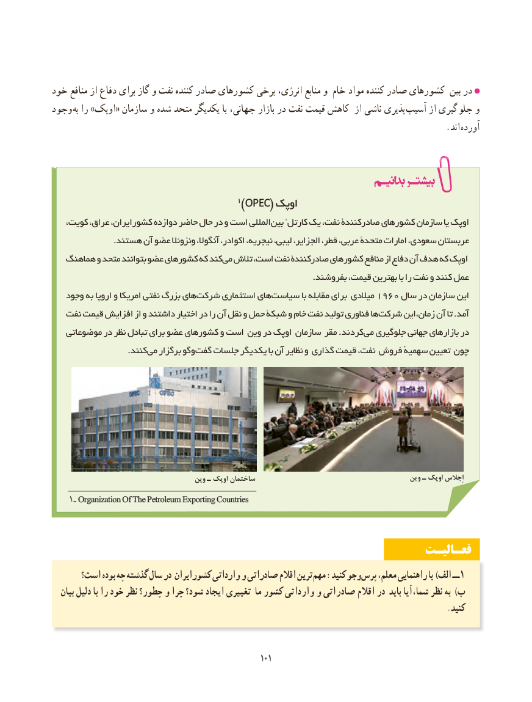

# PDF page 109

خود منافع از دفاع برای گاز و نفت کنندهٔ صادر کشورهای برخی انرژی، منابع و خام مواد کنندهٔ صادر کشورهای بین در
وجود به را »اوپک« سازمان و شده متحد یکدیگر با جهانی، بازار در نفت قیمت کاهش از ناشی پذیری  آسیب از گیری جلو و
                                                . اند آورده

                                  1)OPECOPEC(( اوپکاوپک
   کویت، عراق، ایران، کشور دوازده حاضر حال در و است المللیبین‌     *کارتل یک نفت، صادرکنندة کشورهای سازمان یا اوپک
                      .هستند آن عضو ونزوئال آنگوال، اکوادر، نیجریه، لیبی، الجزایر، قطر، عربی، متحدة امارات سعودی، عربستان
   هماهنگ و متحد بتوانند عضو کشورهای که کندمی‌  تالش است، نفت صادرکنندة کشورهای منافع از دفاع آن هدف که اوپک
                                                                                              .بفروشند قیمت، بهترین با را نفت و کنند عمل
   وجود به اروپا و امریکا نفتی بزرگ هایشرکت‌     استثماری هایسیاست‌           با مقابله برای میالدی 1960 سال در سازمان این
   نفت قیمت افزایش از و داشتند اختیار در را آن نقل و حمل شبکة و خام نفت تولید فناوری هاشرکت‌     این ،آمدزمان آن تا .
   موضوعاتی در نظر تبادل برای عضو کشورهای و است وین در اوپک سازمان مقر . کردند ‌می جلوگیری جهانی بازارهای در
       . کنندمی برگزار وگو گفت جلسات یکدیگر با آن نظایر و گذاری قیمت نفت، فروش سهمیهٔ تعیین چون

                                       وین ـ اوپک ساختمان                                           وین ـ اوپک اِجالس
    1ـ OrganizationOrganization OfOf TheThe PetroleumPetroleum ExportingExporting CountriesCountries

                                                                 فعـالیـت
      است؟ بوده چه گذشته سال در ایران کشور وارداتی و صادراتی اقالم ترینمهم‌  :کنید وجوپرس‌    معلم، راهنمایی با )الف ــ 1
   بیان دلیل با را خود نظر چطور؟ و چرا شود؟ ایجاد تغییری ما کشور وارداتی و صادراتی اقالم در باید شما،آیا نظر به )ب
                                                                                                    .کنید

                                                      101101

