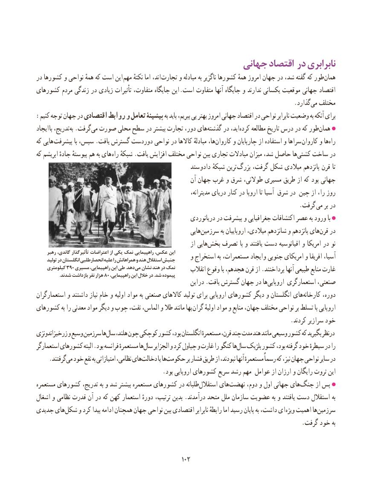

# PDF page 110

جهانی اقتصاد در نابرابری
در کشورها و نواحی همهٔ که است این مهم نکتهٔ اما اند، تجارت و مبادله به ناگزیر کشورها همهٔ امروز جهان در شد، گفته که طور‌همان
کشورهای مردم زندگی در زیادی تأثیرات متفاوت، جایگاه این .است متفاوت آنها جایگاه و ندارند یکسانی موقعیت جهانی اقتصاد
                                                                                      .گذارد‌می مختلف
:کنیم توجه جهان در اقتصادی روابط و تعامل پیشینۀ به باید ببریم، پی بهتر امروز جهانی اقتصاد در نواحی نابرابر وضعیت به آنکه برای
ایجاد با تدریج،به‌ .گرفت ‌می صورت محلی سطح در بیشتر تجارت دور، هایگذشته‌     در اید، ‌کرده مطالعه تاریخ درس در که طورهمان‌
که هایی پیشرفت با سپس، .یافت گسترش دوردست نواحی در کاالها مبادلهٔ ها،کاروان‌     و چارپایان از استفاده و سراها کاروان و هاراه‌
که ابریشم جادهٔ پیوستهٔ هم به های راه شبکهٔ .یافت افزایش مختلف نواحی بین تجاری مبادالت میزان شد، حاصل هاکشتی‌   ساخت در
                                                  ستد دادو شبکهٔ ترین بزرگ گرفت، شکل میالدی پانزدهم قرن تا
                                                         آن جهان غرب و شرق طوالنی، مسیری طریق از که بود جهانی
                                                                       مدیترانه، دریای کنار در اروپا تا آسیا شرق در چین از را، روز
                             . گرفت می بر در
                                                        دریانوردی در پیشرفت و جغرافیایی اکتشافات عصر به ورود با
                                                            هایی‌سرزمین به اروپاییان میالدی، شانزدهم و پانزدهم هایقرن‌   در
                                                                از هاییبخش‌   تصرف با و یافتند دست اقیانوسیه و امریکا در نو
     رهبر          گاندی،                  تأثیرگذار                       اعتراضات                                               از                           یکی                            نمک راهپیمایی                                     عکس،                                                               این     و استخراج به مستعمرات، ایجاد و جنوبی امریکای و افریقا آسیا،     تولید         در انگلستان                   انحصارطلبی                              علیه                                                  را                                 همراهانش                                             و هند استقالل                                       جنبش
    کیلومتری 390 مسیری راهپیمایی، این طی .دهد می نشان هند در نمک      انقالب وقوع با هجدهم، قرن از .پرداختند آنها طبیعی منابع غارت .80شدند بازداشت نفر هزار ،پیمودهراهپیمایی این خالل در .شد
                                                              این در .یافت گسترش جهان در ها‌اروپایی استعمارگری صنعتی،
استعمارگران و داشتند نیاز خام و اولیه مواد به صنعتی کاالهای تولید برای اروپایی کشورهای دیگر و انگلستان هایکارخانه‌       دوره،
کشورهای به را معدنی مواد دیگر و چوب نفت، الماس، و طال مانند بها گران اولیهٔ مواد و منابع جهان، مختلف نواحی بر تسلط با اروپایی
                                                                                     .کردند سرازیر خود
اندونزی زرخیز و وسیع سرزمین هاسال‌   هلند، چون کوچکی کشور بود، انگلستان مستعمرهٔ قرن، چند مدت هند مانند وسیعی کشور که بگیرید درنظر
استعمارگر کشورهای البته .بود فرانسه مستعمرهٔ هاسال‌    الجزایر و کرد چپاول و غارت را کنگو هاسال‌   بلژیک کشور بود، گرفته خود سیطرهٔ در را
 .‌گرفتندمی خود نفع به امتیازاتی نظامی، هایدخالت‌         یا هاحکومت‌         بر فشار طریق از نبودند، آنها مستعمرهٔ رسماً که نیز، جهان نواحی سایر در
                                          .بود اروپایی کشورهای سریع رشد مهم عوامل از ارزان و رایگان ثروت این
مستعمره کشورهای تدریج، به و شد بیشتر مستعمره کشورهای در طلبانه‌استقالل های‌نهضت دوم، و اول جهانی هایجنگ‌      از پس
اشغال و نظامی قدرت آن در که کهن استعمار دورهٔ ترتیب، بدین .درآمدند متحد ملل سازمان عضویت به و یافتند دست استقالل به
جدیدی های ‌شکل و کرد پیدا ادامه همچنان جهان نواحی بین اقتصادی نابرابر رابطهٔ اما رسید پایان به داشت، ای ویژه اهمیت هاسرزمین‌
                                                                                         .گرفت خود به

                                                102102

