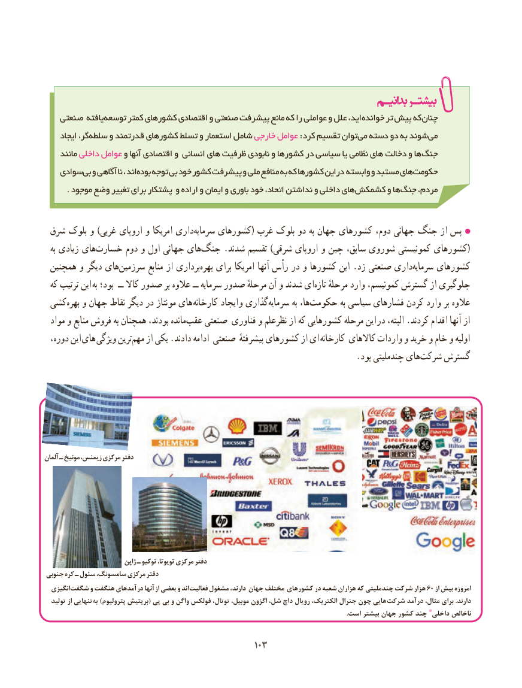

# PDF page 111

صنعتی یافته توسعه کمتر کشورهای اقتصادی و صنعتی پیشرفت مانع که را عواملی و علل اید، خوانده تر پیش که چنان
     ایجاد گر، :سلطه و قدرتمند کشورهای تسلط و استعمار شامل خارجی عوامل   کرد تقسیم توان می دسته دو به شوند می
     مانند داخلی عوامل و آنها اقتصادی و انسانی های ظرفیت نابودی و کشورها در سیاسی یا نظامی های دخالت و ها جنگ
   سوادی بی و آگاهی نا ، اند بوده توجه بی خود کشور پیشرفت و ملی منافع به که کشورها این در وابسته و مستبد های حکومت
. موجود وضع تغییر برای پشتکار و اراده و ایمان و باوری خود اتحاد، نداشتن و داخلی های کشمکش و ها جنگ مردم،

 شرق بلوک و )غربی اروپای و امریکا داریسرمایه‌     کشورهای( غرب بلوک دو به جهان کشورهای دوم، جهانی جنگ از پس
  به زیادی هایخسارت‌       دوم و اول جهانی هایجنگ‌(.شدند تقسیم )شرقی اروپای و چین سابق، شوروی کمونیستی کشورهای
 همچنین و دیگر هایسرزمین‌         منابع از برداریبهره‌    برای امریکا آنها رأس در و کشورها این .زد صنعتی داریسرمایه‌     کشورهای
  که ترتیب این به بود؛  ــ کاال صدور بر عالوه ــ سرمایه صدور مرحلهٔ آن و شدند ای ‌تازه مرحلهٔ وارد کمونیسم، گسترش از جلوگیری
 کشی‌بهره و جهان نقاط دیگر در مونتاژ های  کارخانه ایجاد و گذاری‌سرمایه به ها،حکومت‌           به سیاسی فشارهای کردن وارد بر عالوه
  مواد و منابع فروش به همچنان بودند، ماندهعقب‌    صنعتی فناوری و نظرعلم از که کشورهایی مرحله این در البته، .کردند اقدام آنها از
  دوره، این  های  ویژگی ترینمهم‌   از یکی .دادند ادامه صنعتی پیشرفتهٔ کشورهای از ای  کارخانه کاالهای واردات و خرید و خام و اولیه
         .‌بود چندملیتی های شرکت گسترش

آلمان ـ مونیخ زیمنس، مرکزی دفتر

                           ژاپن ـ توکیو تویوتا، مرکزی دفتر
جنوبی کره ـ سئول سامسونگ، مرکزی دفتر
  انگیزیشگفت‌      و هنگفت درآمدهای آنها از بعضی و اند فعالیت مشغول دارند، جهان مختلف کشورهای در شعبه هزاران که چندملیتی شرکت هزار 60 از بیش امروزه
  تولید از تنهاییبه‌  )پترولیوم بریتیش( پی بی و واگن فولکس توتال، موبیل، اگزون شل، داچ رویال الکتریک، جنرال چون هایی شرکت درآمد مثال، برای .دارند
                                                                                                                                                                                          .است بیشتر جهان کشور چند * داخلی ناخالص

                                              103103

