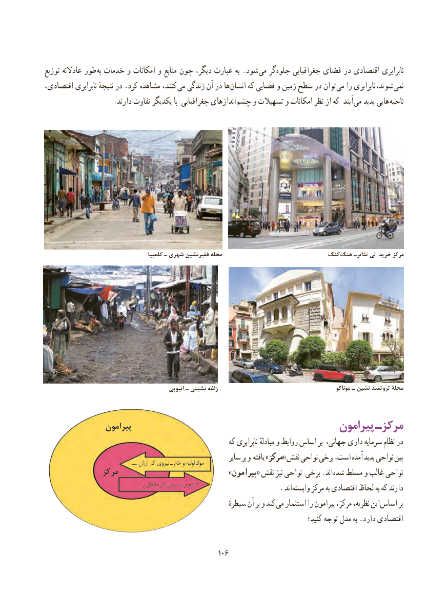

# PDF page 114

توزیع عادالنه طور  به خدمات و امکانات و منابع چون دیگر، عبارت به .شود می گر جلوه جغرافیایی فضای در اقتصادی نابرابری
اقتصادی، نابرابری نتیجهٔ در .کرد مشاهده کنند، می زندگی آن در ها انسان که فضایی و زمین سطح در توان می را نابرابری ،شوند  نمی
 . دارند تفاوت یکدیگر با جغرافیایی اندازهای چشم و تسهیالت و امکانات نظر از که آیند می پدید هایی ناحیه

                                          کلمبیا ـ شهری فقیرنشین محله                           کنگ  هنگ تئاترـ لی خرید مرکز

                                                 اتیوپی ـ نشینی زاغه                                                 موناکو ـ نشین ثروتمند محلۀ

                پیرامون                                         پیرامون مرکزـ
                                                          که نابرابری مبادلهٔ و روابط اساس بر جهانی، داری سرمایه نظام در
                                                                            ..... ارزان کار نیروی ـ خام و اولیه مواد        سایر بر و یافته »مرکز« نقش نواحی برخی است، آمده پدید نواحی بین
              مرکز                                     »پیرامون« نقش نیز نواحی برخی .اند شده مسلط و غالب نواحی
                                                                                             .... و ای کارخانه مصرفی کاالهای           . اند وابسته مرکز به اقتصادی لحاظ به که دارند
                                                                سیطرهٔ آن بر و کند می استثمار را پیرامون مرکز، نظریه، این اساس بر
                                                                                          کنید؛ توجه مدل به .دارد اقتصادی

                                               106106

