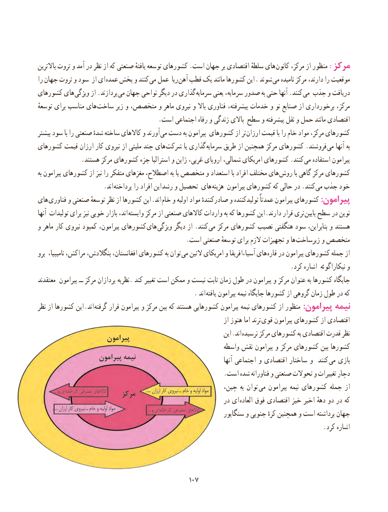

# PDF page 115

باالترین ثروت و آمد در نظر از که صنعتی یافتهٔ توسعه کشورهای .است جهان بر اقتصادی سلطهٔ های کانون مرکز، از منظور :مرکز
را جهان ثروت و سود از ای عمده بخش و کنند می عمل ربا آهن قطب یک مانند کشورها این . شوند  می نامیده مرکز دارند، را موقعیت
کشورهای های ویژگی از .پردازند می جهان نواحی دیگر در گذاری سرمایه یعنی سرمایه، صدور به حتی آنها .کنند می جذب و دریافت
توسعهٔ برای مناسب های  ساخت زیر و متخصص، و ماهر نیروی و باال فناوری پیشرفته، خدمات و نو صنایع از برخورداری مرکز،
                                       .است اجتماعی رفاه و زندگی باالی سطح و پیشرفته نقل و حمل مانند اقتصادی
بیشتر سود با را صنعتی شدهٔ ساخته کاالهای و آورند  می دست به پیرامون کشورهای از تر ارزان قیمت با را خام مواد مرکز، کشورهای
کشورهای قیمت ارزان کار نیروی از ملیتی چند های شرکت یا گذاری سرمایه طریق از همچنین مرکز کشورهای .فروشند می آنها به
              .هستند مرکز کشورهای جزء استرالیا و ژاپن غربی، اروپای شمالی، امریکای کشورهای .کنند می استفاده پیرامون
به پیرامون کشورهای از نیز را متفکر مغزهای اصطالح، به یا متخصص و استعداد با افراد مختلف های روش با گاهی مرکز کشورهای
            . اند پرداخته را افراد این رشد و تحصیل های هزینه پیرامون کشورهای که حالی در .کنند می جذب خود
های فناوری و صنعتی توسعهٔ نظر از کشورها این .اند خام و اولیه مواد صادرکنندهٔ و تولیدکننده عمدتاً پیرامون کشورهای :پیرامون
آنها تولیدات برای نیز خوبی بازار اند، وابسته مرکز از صنعتی کاالهای واردات به که کشورها این .دارند قرار تری پایین سطح در نوین
و ماهر کار نیروی کمبود پیرامون، کشورهای های  ویژگی دیگر از .کنند می مرکز کشورهای نصیب هنگفتی سود بنابراین، و هستند
                                                .است صنعتی توسعهٔ برای الزم تجهیزات و ها زیرساخت و متخصص
پرو نامیبیا، مراکش، بنگالدش، افغانستان، کشورهای به توان  می التین امریکای و آسیا،افریقا های قاره در پیرامون کشورهای جمله از
                                                                                 .کرد اشاره نیکاراگوئه و
معتقدند پیرامون ــ مرکز پردازان نظریه. کند تغییر است ممکن و نیست ثابت زمان طول در پیرامون و مرکز عنوان به کشورها جایگاه
                                                  . اند یافته پیرامون نیمه جایگاه کشورها از گروهی زمان طول در که
نظر از کشورها این .اند گرفته قرار پیرامون و مرکز بین که هستند کشورهایی پیرامون نیمه کشورهای از منظور :پیرامون نیمه
                                                                          از هنوز اما ترند قوی پیرامون کشورهای از اقتصادی
                                                                        این .اند  نرسیده مرکز کشورهای به اقتصادی قدرت نظر                     پیرامون
                                                           واسطه نقش پیرامون و مرکز کشورهای بین کشورها
                  پیرامون نیمه                                                                                        آنها اجتماعی و اقتصادی ساختار و  کنند  می بازی
                                                            .است شده فناورانه و صنعتی تحوالت و تغییرات دچار
                  .... و ای کارخانه مصرفی کاالهای                                        ..... ارزان کار نیروی ـ خام و اولیه مواد    چین، به توان  می پیرامون نیمه کشورهای جمله از                        مرکز                                                             در ای العاده فوق اقتصادی خیز اخیر دههٔ دو در که
               ..... ارزان کار نیروی ـ خام و اولیه مواد                                     .... و ای کارخانه مصرفی کاالهای                                                                سنگاپور و جنوبی کرهٔ همچنین و است برداشته جهان
                                                                                            .کرد اشاره

                                             107107

