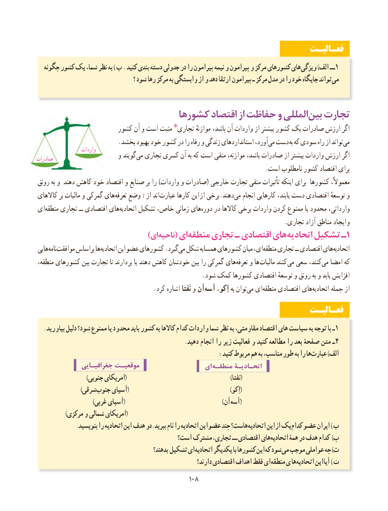

# PDF page 116

فعـالیـت
  چگونه کشور یک شما، نظر به ) ب . کنید بندی دسته جدولی در را پیرامون نیمه و پیرامون و مرکز کشورهای های ویژگی )الف ــ 1
                                          ؟ شود رها مرکز به وابستگی از و دهد ارتقا پیرامون ـ مرکز مدل در را خود جایگاه تواند می

                           کشورها اقتصاد از حفاظت و المللیبین‌  تجارت
                       کشور آن و است مثبت تجاری٭ موازنهٔ باشد، آن واردات از بیشتر کشور یک صادرات ارزش اگر
 .‌بخشد بهبود خود کشور در را رفاه و زندگی استانداردهای آورد،می دست به که سودی راه از تواندمی‌
                   واردات
صادرات                     و گویندمی‌  تجاری کسری آن به که است منفی موازنه، باشد، صادرات از بیشتر واردات ارزش اگر
                                                                         .است نامطلوب کشور اقتصاد برای
رونق به و دهند کاهش خود اقتصاد و صنایع بر را )واردات و صادرات( خارجی تجارت منفی تأثیرات اینکه برای کشورها معموالً،
کاالهای بر مالیات و گمرکی هایتعرفه‌   وضع :از اند‌عبارت کارها این  از برخی.دهندمی‌   انجام کارهایی یابند، دست اقتصادی توسعهٔ و
ای‌منطقه تجاری ــ اقتصادی هایاتحادیه‌     تشکیل خاص، زمانی هایدوره‌    در کاالها برخی واردات کردن ممنوع یا محدود وارداتی،
        . تجاری آزاد مناطق ایجاد و
                 )‌ایناحیه( ایمنطقه‌     تجاری ـ اقتصادی هایاتحادیه‌     تشکیل ـ1
هایینامه‌  موافقت‌      براساس هااتحادیه‌      این عضو کشورهای .گیردمی‌ شکل همسایه کشورهای میان ای،منطقه‌    تجاری ــ اقتصادی هایاتحادیه‌
منطقه، کشورهای بین تجارت تا دارند بر یا دهند کاهش خودشان بین را گمرکی هایتعرفه‌    و ها مالیات کنند  می سعی کنند،می‌  امضا که
                                                     .شود کمک کشورها اقتصادی توسعهٔ و رونق به و یابد افزایش
                                      .کرد اشاره نَفتا و آن‌آسه اِکو، به توان‌می ای‌منطقه اقتصادی های‌اتحادیه جمله از
                                                                 فعـالیـت
   .بیاورید دلیل شود؟ ممنوع یا محدود باید کشور به کاالها کدام واردات شما نظر به مقاومتی، اقتصاد های سیاست به توجه با ـ 1
                                                   .دهید انجام را زیر فعالیت و کنید مطالعه را بعد صفحۀ متن ـ2
                                                  :کنید مربوط هم به مناسب، طور به را هاعبارت‌       )الف
              جغرافیـایی موقعیـت                   ای منطقـه اتحـادیـۀ
                         )جنوبی امریکای(                                                    )نفتا(
     )‌شرقیجنوب آسیای(                                                   )اِکو(
 )‌غربی آسیای(                                                 )آن آسه(
               )مرکزی و شمالی امریکای(
 . بنویسید را اتحادیه این هدف دو.ببرید نام را اتحادیه این عضو چند هاست؟اتحادیه‌      این از یککدام‌  عضو ایران ) ب
                                       است؟ مشترک تجاری، ــ اقتصادی هایاتحادیه‌      همۀ در هدف کدام )پ
                                               بدهند؟ تشکیل ایاتحادیه‌     یکدیگر با کشورها این که شودمی‌  موجب عواملی چه )ت
                                                                دارند؟ اقتصادی اهداف فقط ای منطقه ی هااتحادیه‌      این آیا ) ث
                                             108108

