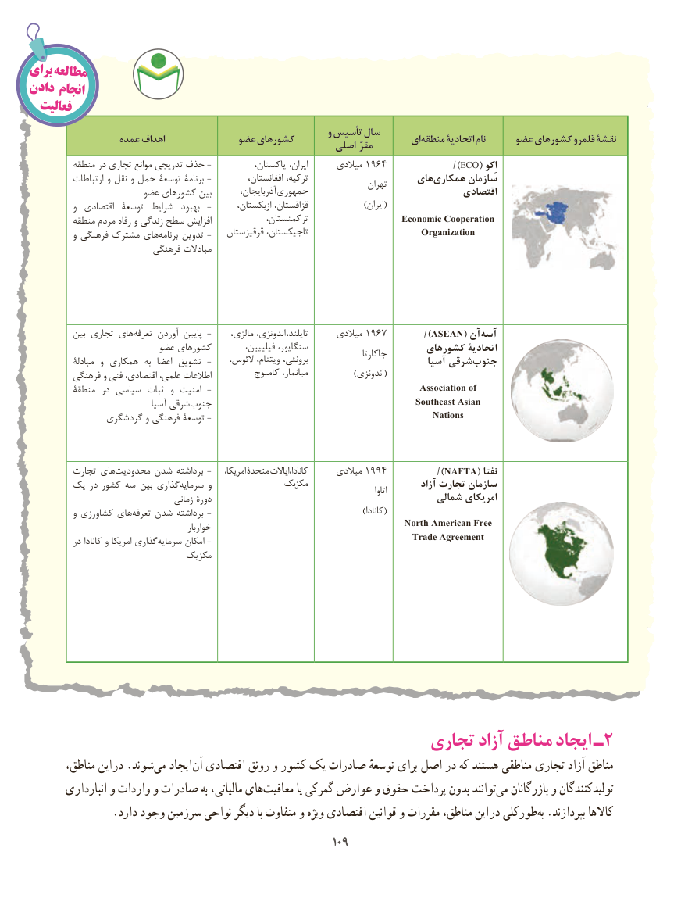

# PDF page 117

برایمطالعه
دادن انجام
  فعالیت
                                                                   و تأسیس سال                 عمده اهداف            عضو کشورهای                        ایمنطقه‌      اتحادیة نام     عضو کشورهای قلمرو نقشة                                                           اصلی مقرّ
          منطقه در تجاری موانع تدریجی حذف -           پاکستان، ایران،      میالدی 1964                 )/ECO( اِکو
            ارتباطات و نقل و حمل توسعة برنامة -          افغانستان، ترکیه،                    های ‌همکاری سازمان                                                                                       تهران                      عضو کشورهای بین        آذربایجان، جمهوری                                اقتصادی
            و  اقتصادی  توسعة  شرایط  بهبود  -       ازبکستان، قزاقستان،                 )ایران(
          منطقه مردم رفاه و زندگی سطح افزایش             ترکمنستان،                   Economic Cooperation
            و فرهنگی مشترک های‌برنامه تدوین -    قرقیزستان تاجیکستان،                         Organization
                           فرهنگی مبادالت

          بین تجاری های ‌تعرفه آوردن پایین -     مالزی، اندونزی،  ،تایلند      میالدی 1967          )/ASEAN( آن‌آسه
                         عضو کشورهای         فیلیپین، سنگاپور،                     کشورهای اتحادیة                                                                                              جاکارتا             مبادلة  و همکاری  به  اعضا تشویق -    الئوس، ویتنام، برونئی،                          آسیا شرقیجنوب‌
          فرهنگی و فنی اقتصادی، علمی، اطالعات          کامبوج میانمار،              )اندونزی(
          منطقة در سیاسی ثبات  و امنیت -                                                 Association of
                                آسیا شرقی ‌جنوب                                              Southeast Asian
               گردشگری و فرهنگی توسعة -                                                  Nations

          تجارت های‌محدودیت شدن برداشته -    امریکا، متحدة ایاالت ،کانادا      میالدی 1994         /)NAFTA( نفتا
               ‌یک در کشور سه بین گذاری‌سرمایه و               مکزیک                             آزاد تجارت سازمان                                                                                                                                           اتاوا                                     زمانی دورة                                            شمالی امریکای
            و کشاورزی های‌تعرفه شدن برداشته -                                              )کانادا(
                                              خواربار                                        North American Free
                                                                             Trade Agreement           در کانادا و امریکا گذاریسرمایه‌      امکان -
                               مکزیک

                                            تجاری آزاد مناطق ایجاد ـ 2
   ،اینمناطق       در .شوندمی‌   ایجاد آن اقتصادی رونق و کشور یک صادرات توسعهٔ برای اصل در که هستند مناطقی تجاری آزاد مناطق
        انبارداری و واردات و صادرات به مالیاتی، هایمعافیت‌          یا گمرکی عوارض و حقوق پرداخت بدون توانندمی‌   بازرگانان و تولیدکنندگان
. دارد وجود سرزمین نواحی دیگر با متفاوت و ویژه اقتصادی قوانین و مقررات مناطق، این در طورکلی‌به .بپردازند کاالها
                                                       109109

