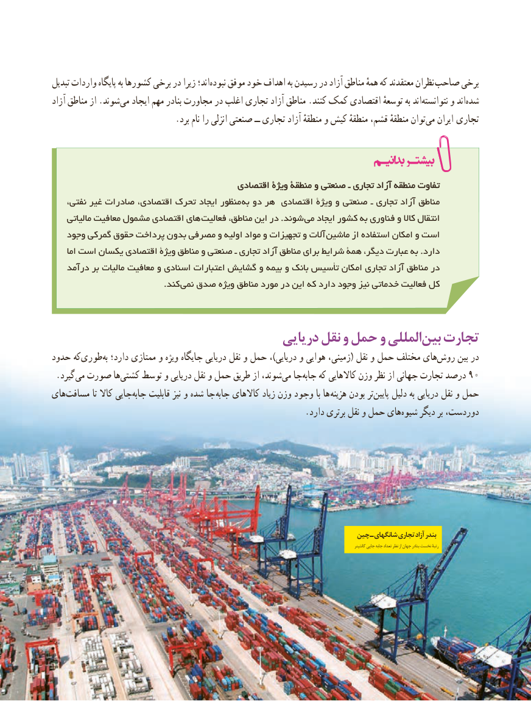

# PDF page 118

تبدیل واردات پایگاه به کشورها برخی در زیرا اند؛نبوده‌    موفق خود اهداف به رسیدن در آزاد مناطق همهٔ که معتقدند نظران صاحب برخی
آزاد مناطق از .شوندمی‌   ایجاد مهم بنادر مجاورت در اغلب تجاری آزاد مناطق .کنند کمک اقتصادی توسعهٔ به اند‌نتوانسته و اند شده‌
 .‌برد نام را انزلی صنعتی ــ تجاری آزاد منطقهٔ و کیش منطقهٔ قشم، منطقهٔ توانمی ایران  تجاری

                                         اقتصادیاقتصادی ویژۀویژۀ منطقۀمنطقۀ وو صنعتیصنعتی ــ تجاریتجاری آزادآزاد منطقهمنطقه تفاوتتفاوت
    نفتی، غیر صادرات اقتصادی، تحرک ایجاد منظور به دو هر اقتصادی ویژۀ و صنعتی ـ تجاری آزاد مناطق
    مالیاتی معافیت مشمول اقتصادی های فعالیت مناطق، این در .شوند  می ایجاد کشور به فناوری و کاال انتقال
   وجود گمرکی حقوق پرداخت بدون مصرفی و اولیه مواد و تجهیزات و آالت  ماشین از استفاده امکان و است
     اما است یکسان اقتصادی ویژۀ مناطق و صنعتی ـ تجاری آزاد مناطق برای شرایط همۀ دیگر، عبارت به .دارد
   درآمد بر مالیات معافیت و اسنادی اعتبارات گشایش و بیمه و بانک تأسیس امکان تجاری آزاد مناطق در
            . کند نمی صدق ویژه مناطق مورد در این که دارد وجود نیز خدماتی فعالیت کل

                                      دریایی نقل و حمل و المللیبین‌  تجارت
حدود کهطوری‌         ‌به دارد؛ ممتازی و ویژه جایگاه دریایی نقل و حمل ،)دریایی و هوایی زمینی،( نقل و حمل مختلف های‌روش بین در
. گیرد می صورت ها‌کشتی توسط و دریایی نقل و حمل طریق از شوند،می‌  جا ‌جابه۹۰که کاالهایی وزن نظر از جهانی تجارت درصد
های‌مسافت تا کاال جایی‌جابه قابلیت نیز و شده جا جابه کاالهای زیاد وزن وجود با ها هزینه بودن تر‌پایین دلیل به دریایی نقل و حمل
     .‌دارد برتری نقل و حمل هایشیوه دیگر بر دوردست،

                                                                       چین ـ شانگهای تجاری آزاد بندر
                                                                                                                                                                                             کانتینر جایی جابه تعداد نظر از جهان بنادر نخست رتبۀ

