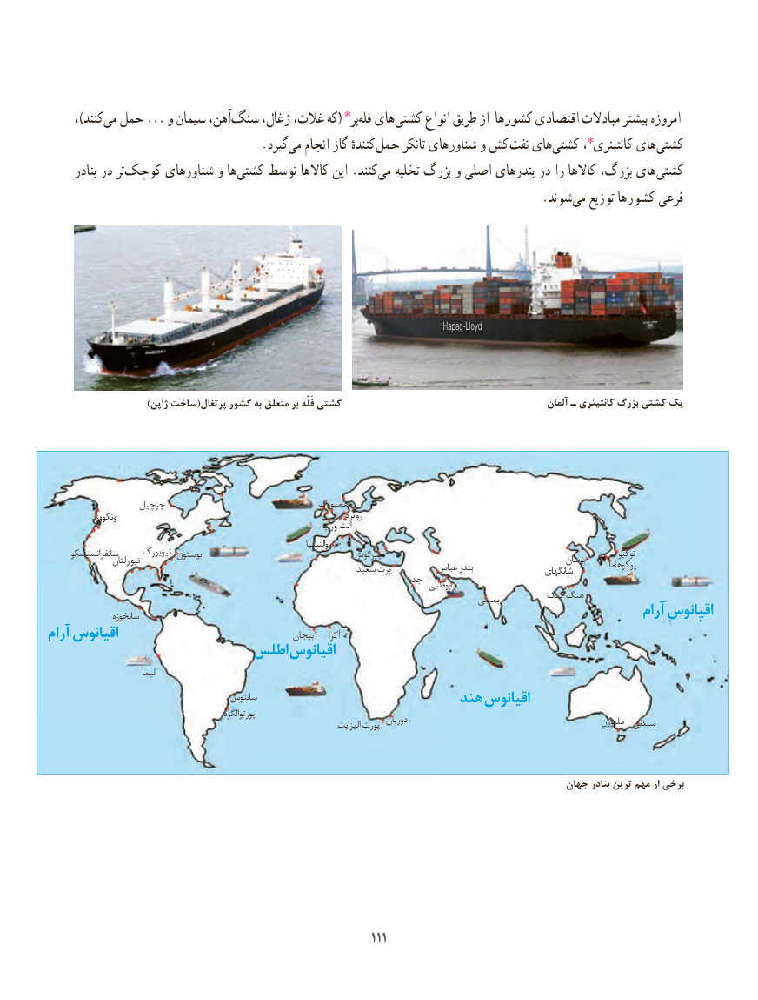

# PDF page 119

،)کنندمی‌  حمل ... و سیمان آهن،سنگ‌     زغال، غالت، که( بر٭‌فله هایکشتی‌     انواع طریق از کشورها اقتصادی مبادالت بیشتر امروزه
              .‌گیرد می انجام گاز کنندهٔ ‌حمل تانکر شناورهای و کش نفت های‌کشتی کانتینری٭، هایکشتی‌
      بنادر در ترکوچک‌      شناورهای و ها ‌کشتی توسط کاالها این .کنندمی‌   تخلیه بزرگ و اصلی بندرهای در را کاالها بزرگ، های‌کشتی
                             .‌شوند می توزیع کشورها فرعی

                                                                                                                Hapag-Lloyd

                          )ژاپن ساخت(پرتغال کشور به متعلق بر فَلّه کشتی                                               آلمان ـ کانتینری بزرگ کشتی یک

                  چرچیل                                   هامبورگ
             ونکوور                                                                 روتردام
                                                       ورپ آنت
                                                                                والنسیا
      سانفرانسیسکو      نیویورک بوستون                                       پیرائوس                                                                 توکیو                     نیوارلئان                                                                                                        بوسان                                                                سعید پرت         عباس بندر                 شانگهای          یوکوهاما
                                                                         جده                                                                                                 ابوظبی
                                                                                                  بمبئی        کنگ هنگ
                 سانخوزه                                                                                       آرام اقیانوس
آرام اقیانوس                                            آبیجان    آکرا
                       اطلس اقیانوس
                            لیما
                                        سانتوس                                                    هند اقیانوس
                                                       پورتوالگره                                                                                             دوربان                                                  ملبورن  سیدنی                                                                                       الیزابت پورت

                                                                                             جهان بنادر ترین مهم از برخی

                                                            111111

