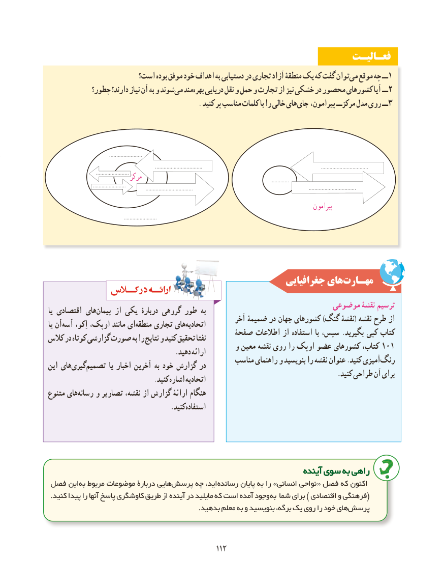

# PDF page 120

فعـالیـت
                      است؟ بوده موفق خود اهداف به دستیابی در تجاری آزاد منطقۀ یک که گفت توانمی‌  موقع چه ــ 1
            چطور؟ دارند؟ نیاز آن به و شوندمی‌  مندبهره‌   دریایی نقل و حمل و تجارت از نیز خشکی در محصور کشورهای آیا ــ 2
                                              . کنید پر مناسب کلمات با را خالی های جای پیرامون، مرکزــ مدل روی ــ 3

                                           .......................
                                                                           .................................                                                                                   .................................
                                 ....................... مرکز                                                                                          .............                                .......................                                                                     .................................                                                                                 .................................
                                                                                                 پیرامون
                                                     .......................

                                                      جغرافیایی هایمهـارت‌
                                                               موضوعی نقشۀ ترسیمیا اقتصادی هایپیمان‌     از یکی دربارۀ گروهی طور به                                                      آخر ضمیمۀ در جهان کشورهای )گنگ نقشۀ( نقشه طرح ازیا آنآسه‌     اِکو، اوپک، مانند ایمنطقه‌    تجاری هایاتحادیه‌                                         صفحۀ اطالعات از استفاده با سپس، .بگیرید کپی کتابکالس در کوتاه گزارشی صورت به را نتایج و کنید تحقیق نفتا                                             و معین نقشه روی را اوپک عضو کشورهای کتاب، 101                                       .دهید ارائه                                                 مناسب راهنمای و بنویسید را نقشه عنوان .کنید آمیزیرنگ‌این هایگیری‌   تصمیم‌         یا اخبار آخرین به خود گزارش در                                                                                        .کنید طراحی آن برای      .‌کنید اشاره اتحادیه
متنوع هایرسانه‌    و تصاویر نقشه، از گزارش ارائۀ هنگام
                                     .کنیداستفاده

                                                                   آیندهآینده سویسوی بهبه راهیراهی
فصل این به مربوط موضوعات دربارة هاییپرسش‌     چه اید، رسانده پایان به را »انسانی نواحی « فصل که اکنون
 .کنید پیدا را آنها پاسخ کاوشگری طریق از آینده در مایلید که است آمده وجود (به شما برای ) اقتصادی و فرهنگی
                                                                 .بدهید معلم به و بنویسید برگه، یک روی را خود هایپرسش‌

                                               112112

