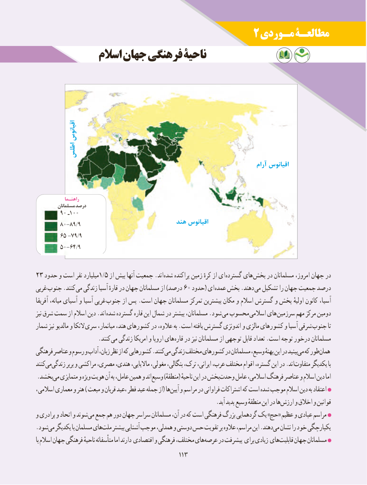

# PDF page 121

2 مـوردی مطالعـۀ
             اسالم جهان فرهنگی ناحیۀ

                اقیانوس
         اطلس
                                                                                     آرام اقیانوس

              راهنـما
          مسلمانان درصد
        90 ـ100
                                         هند اقیانوس        80-89/9
        65 -79/9
        50-64/9

23 حدود و است نفر میلیارد1/5 از بیش آنها جمعیت .اند شده پراکنده زمین کرهٔ از ای گسترده های بخش در مسلمانان امروز، جهان در
غربی جنوب .کنند می زندگی آسیا قارهٔ در جهان مسلمانان از )درصد 60 حدود( ای عمده بخش .دهند می تشکیل را جهان جمعیت درصد
آفریقا میانه، آسیای و آسیا غربی جنوب از پس .است جهان مسلمانان تمرکز بیشترین مکان و اسالم گسترش و پخش اولیهٔ کانون آسیا،
نیز شرق سمت از اسالم دین .اند شده گسترده قاره این شمال در بیشتر مسلمانان، .شود می محسوب اسالمی های سرزمین مهم مرکز دومین
شمار نیز مالدیو و النکا سری میانمار، هند، کشورهای در عالوه، به .است یافته گسترش اندونزی و مالزی کشورهای و آسیا شرقی جنوب تا
         . کنند می زندگی امریکا و اروپا های قاره در نیز مسلمانان از توجهی قابل تعداد .است توجه درخور مسلمانان
فرهنگی عناصر و رسوم و آداب زبان، نظر از که کشورهایی .کنندمی‌  زندگی مختلف کشورهای در مسلمانان وسیع، پهنهٔ این در بینیدمی‌  که طورهمان‌
کنندمی‌  زندگی‌       بربر و مراکشی مصری، هندی، ماالیایی، مغولی، بنگالی، ترک، ایرانی، عرب، مختلف اقوام گستره، این در .اندمتفاوت‌      یکدیگر با
.بخشدمی‌  متمایزی و ویژه هویت آن به عامل، همین و اند وسیع )منطقهٔ( ناحیهٔ این در بخشوحدت‌     عامل اسالمی، فرهنگ عناصر و اسالم دین اما
، اسالمی معماری و هنر ) مبعث و قربان ،عید فطر عید جمله از( هاآیین‌   و مراسم در فراوانی اشتراکات که است شده موجب اسالم دین به اعتقاد
                                                             .آید پدید وسیع منطقهٔ این در هاارزش‌    و اخالق و قوانین
و برادری و اتحاد و شوند می جمع هم دور جهان سراسر مسلمانان آن، در که است فرهنگی بزرگ گردهمایی یک »حج« عظیم و عبادی مراسم
.شودمی‌  یکدیگر با مسلمان هایملت‌    بیشتر آشنایی موجب همدلی، و دوستی حس تقویت بر عالوه مراسم، این .دهندمی‌  نشان را خود یکپارچگی
با اسالم جهان فرهنگی ناحیهٔ متأسفانه اما دارند اقتصادی و فرهنگی مختلف، هایعرصه‌    در پیشرفت‌       برای زیادی هایقابلیت‌    جهان مسلمانان
                                             113113113113

