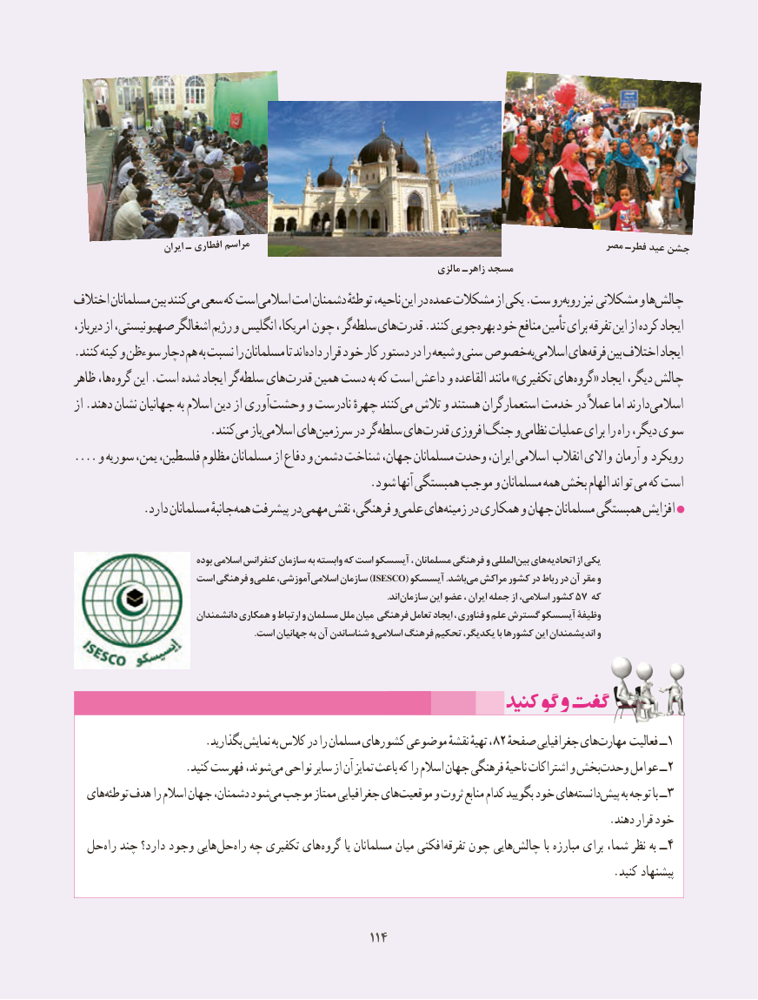

# PDF page 122

ایران ـ افطاری مراسم                                                          مصر فطرـ عید جشن
                                                                                مالزی زاهرـ مسجد
اختالف مسلمانان بین کنند می سعی که است اسالمی امت دشمنان توطئهٔ ناحیه، این در عمده مشکالت از یکی .ست رو روبه نیز مشکالتی و ها چالش
دیرباز، از صهیونیستی، اشغالگر رژیم و انگلیس امریکا، چون ، گر سلطه های قدرت .کنند جویی بهره خود منافع تأمین برای تفرقه این از کرده ایجاد
. کنند کینه و سوءظن دچار هم به نسبت را مسلمانان تا اندداده قرار خود کار دستور در را شیعه و سنی خصوص به اسالمی های فرقه بین اختالف ایجاد
ظاهر ها، گروه این .است شده ایجاد گر سلطه های قدرت همین دست به که است داعش و القاعده مانند »تکفیری های گروه« ایجاد دیگر، چالش
از .دهند نشان جهانیان به اسالم دین از آوری وحشت و نادرست چهرهٔ کنند می تالش و هستند استعمارگران خدمت در عمالً اما دارند اسالمی
          . کنندمی باز اسالمی های سرزمین در گر سلطه های قدرت افروزی جنگ و نظامی عملیات برای را راه دیگر، سوی
.... و سوریه یمن، فلسطین، مظلوم مسلمانان از دفاع و دشمن شناخت جهان، مسلمانان وحدت ایران، اسالمی انقالب واالی آرمان و رویکرد
                                                 .شود آنها همبستگی موجب و مسلمانان همه بخش الهام تواند می که است
 . دارد مسلمانان جانبهٔهمه پیشرفت در مهمی نقش فرهنگی، و علمی های زمینه در همکاری و جهان مسلمانان همبستگی افزایش

                              بوده اسالمی کنفرانس سازمان به وابسته که است آیسسکو ، مسلمانان فرهنگی و المللی بین های اتحادیه از یکی
                    است فرهنگی و علمی آموزشی، )اسالمی سازمان ISESCO( آیسسکو .باشد می مراکش کشور در رباط در آن مقر و
                                                                                                                                     .اند سازمان این عضو ، ایران جمله از ،اسالمی کشور 57 که
                          دانشمندان همکاری و ارتباط و مسلمان ملل میان فرهنگی تعامل ایجاد ، فناوری و علم گسترش آیسسکو وظیفۀ
   . است جهانیان به آن شناساندن واسالمی فرهنگ تحکیم یکدیگر، با کشورها این اندیشمندان و

                       .بگذارید نمایش به کالس در را مسلمان کشورهای موضوعی نقشهٔ تهیهٔ ،82 صفحهٔهایجغرافیایی   مهارت‌      فعالیت ــ1
                    .کنید فهرست شوند، می نواحی سایر از آن تمایز باعث که را اسالم جهان فرهنگی ناحیهٔ اشتراکات و بخشوحدت‌     عوامل ــ 2
  هایتوطئه‌   هدف را اسالم جهان دشمنان، شودمی‌ موجب ممتاز جغرافیایی هایموقعیت‌      و ثروت منابع کدام بگویید خود هایدانسته‌    پیش‌     به توجه با ــ3
                                                                                               .دهند قرار خود
  حل ‌راه چند دارد؟ وجود هاییحل‌     ‌راه چه تکفیری های ‌گروه یا مسلمانان میان افکنی‌تفرقه چون هایی ‌چالش با مبارزه برای شما، نظر به ــ4
                                                                                                .کنید پیشنهاد

                                                114114114114

