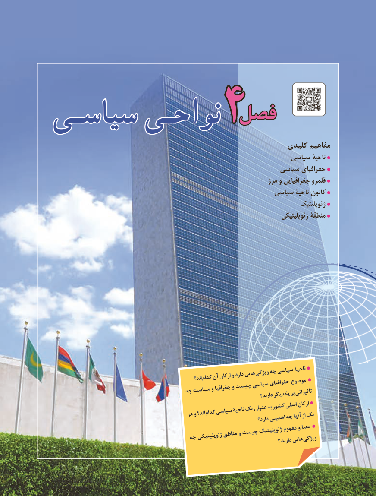

# PDF page 123

فصلفصلسیاسـیسیاسـی نواحـینواحـی       4          کلیدی مفاهیم
                                                             سیاسی ناحیة
                                                          سیاسی جغرافیای
                                                                        مرز و جغرافیایی قلمرو
                                                         سیاسی ناحیۀ کانون
                                                                                        ژئوپلیتیک
                                                                                   ژئوپلیتیکی منطقۀ

                                                             اند؟ کدامآنارکانوداردهایی ویژگیچهسیاسیناحیة                                                                        موضوع                                                                                  جغرافیای                                  چه سیاست و جغرافیا و چیست سیاسی                                                                                                         تأثیراتی                                                                           یکدیگربر                                                                                        دارند؟
                                                                                                  ارکان                                                                  کشوراصلی                                                                                 به                                        هرواند؟ کدامسیاسیناحیۀیکعنوان                                                                                                              ازیک                                                             چهآنها                                                                             اهمیتی                                                                                    دارد؟
                                                                               مفهوم و معنا                                                                             ژئوپلیتیک                                                        مناطق و چیست                                    چه ژئوپلیتیکی                                                                 ؟دارندهایی ویژگی

