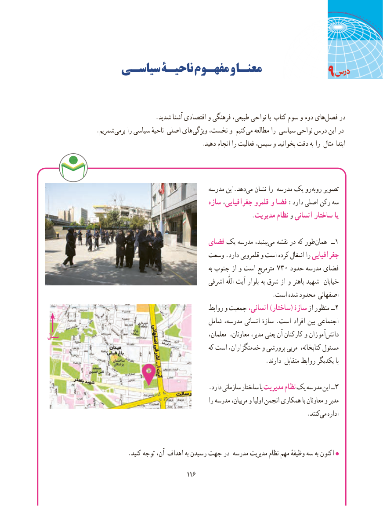

# PDF page 124

سیاسـی ناحیـة مفهـوم و معنـا                                           9

                                   .شدید آشنا اقتصادی و فرهنگی طبیعی، نواحی با کتاب سوم و دوم هایفصل‌    در
     . شمریم برمی را سیاسی ناحیهٔ اصلی های ویژگی نخست، و کنیم می مطالعه را سیاسی نواحی درس این در
                                                  .دهید انجام را فعالیت سپس، و بخوانید دقت به را مثال ابتدا

                                                   مدرسه این.دهد‌می نشان را مدرسه یک رو  روبه تصویر
                                                   سازه جغرافیایی، قلمرو و فضا :دارد اصلی رکن سه
                                                                  .مدیریت نظام و انسانی ساختار یا

                                        فضای یک مدرسه بینید، می نقشه در که طور همان  ــ1
                                         وسعت .دارد قلمرویی و است کرده اشغال را جغرافیایی
                                                                                    به جنوب از و است مترمربع 730 حدود مدرسه فضای
                                                    اشرفی  اللّٰه آیت بلوار به شرق از و باهنر شهید  خیابان
                                                                         .است شده محدود اصفهانی
                                                       روابط و جمعیت انسانی، )ساختار( سازۀ از منظور ــ2
                                                 شامل مدرسه، انسانی سازهٔ . است افراد بین اجتماعی
شمال                                                          معلمان، معاونان، مدیر، یعنی آن کارکنان و آموزان‌دانش
                                                           که است خدمتگزاران، و پرورشی مربی کتابخانه، مسئول
                                                                       .دارند متقابل روابط یکدیگر با

                                                    .دارد سازمانی ساختار یا مدیریت نظام یک مدرسه این ــ3
                                                                   را مدرسه مربیان، و اولیا انجمن همکاری با معاونان و مدیر
                                   .‌کنندمی اداره

                          .کنید توجه آن، اهداف به رسیدن جهت در مدرسه مدیریت نظام مهم وظیفهٔ سه به اکنون
                                             116116

