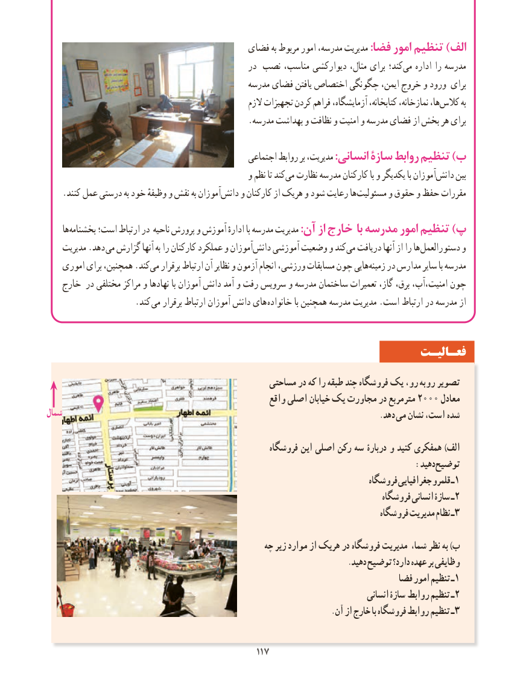

# PDF page 125

فضای به مربوط امور مدرسه، مدیریت :فضا امور تنظیم )الف
                                                 در نصب مناسب، دیوارکشی مثال، برای کند؛می‌   اداره را مدرسه
                                                                      )مدیریت(دفتر     مدرسه فضای یافتن اختصاص چگونگی ایمن، خروج و ورود برای
                                                         الزم تجهیزات کردن فراهم آزمایشگاه، کتابخانه، نمازخانه، ها،کالس‌       به
                                                .مدرسه بهداشت و نظافت و امنیت و مدرسه فضای از بخش هر برای
                                                 اجتماعی روابط بر مدیریت، :انسانی سازۀ روابط تنظیم )ب
                                                و نظم تا کند‌می نظارت مدرسه کارکنان با و یکدیگر با آموزان‌دانش بین
.‌کنند عمل درستی به خود وظیفهٔ و نقش به آموزان دانش و کارکنان از هریک و شود رعایت ها ‌مسئولیت و حقوق و حفظ مقررات
     هابخشنامه‌     است؛ ارتباط در ناحیه پرورش و آموزش ادارهٔ با مدرسه مدیریت :آن از خارج با مدرسه امور تنظیم )پ
    مدیریت .دهد  می گزارش آنها به را کارکنان عملکرد و آموزان ‌دانش آموزشی وضعیت و کندمی‌  دریافت آنها از را ها ‌دستورالعمل و
    اموری برای همچنین، .کند ‌می برقرار ارتباط آن نظایر و آزمون انجام ورزشی، مسابقات چون هایی‌زمینه در مدارس سایر با مدرسه
   خارج در مختلفی مراکز و نهادها با آموزان دانش آمد و رفت سرویس و مدرسه ساختمان تعمیرات گاز، برق، امنیت،آب، چون
          . کند می برقرار ارتباط آموزان دانش های خانواده با همچنین مدرسه مدیریت .است ارتباط در مدرسه از

                                                                 فعـالیـت
                                                  مساحتی در که را طبقه چند فروشگاه یک رو،‌ روبه تصویر
                                                       واقع اصلی خیابان یک مجاورت در مترمربع 2000 معادل
شمال                                                                                 .دهد ‌می نشان است، شده

                                                      فروشگاه این اصلی رکن سه دربارۀ و کنید همفکری )الف
                                                                           :دهید توضیح
                                                                              فروشگاه جغرافیایی قلمرو ـ1
                                                                                 فروشگاه انسانی سازۀ ـ 2
                                                                                 فروشگاه مدیریت نظام ـ 3

                                                 چه زیر موارد از هریک در فروشگاه مدیریت شما، نظر به )ب
                                                                             .دهید توضیح دارد؟ عهده بر وظایفی
                                                                           فضا امور تنظیم ١ـ
                                                                                        انسانی سازۀ روابط تنظیم ٢ـ
                                                                         .آن از خارج با فروشگاه روابط تنظیم ٣ـ

                                               117117

