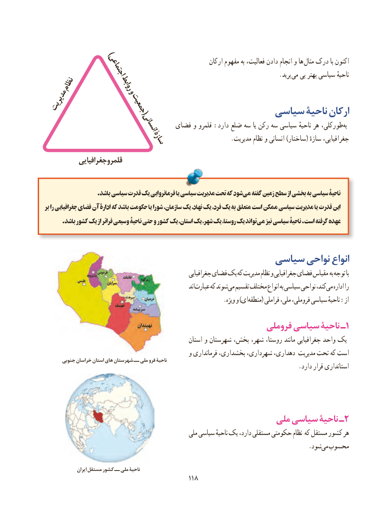

# PDF page 126

ارکان مفهوم به فعالیت، دادن انجام و ها مثال درک با اکنون    )اجتماعی                                  . برید می پی بهتر سیاسی ناحیهٔ
   نظام          روابط
مدیریت    وجمعیت(                                      سیاسی ناحیة ارکان
                          انسانی    فضای و قلمرو :دارد ضلع سه یا رکن سه سیاسی ناحیهٔ هر طورکلی، ‌به
                      سازۀ                    .مدیریت نظام و انسانی )ساختار( سازهٔ جغرافیایی،
           جغرافیاییقلمرو

                      .باشد سیاسی قدرت یک فرمانروایی یا سیاسی مدیریت تحت که شودمی‌   گفته زمین سطح از بخشی به سیاسی ناحیۀ
بر را جغرافیایی فضای آن ادارۀ که باشد حکومت یا شورا سازمان، یک نهاد، یک فرد، یک به متعلق است ممکن سیاسی مدیریت یا قدرت این
       .باشد کشور یک از فراتر وسیعی ناحیۀ حتی و کشور یک استان، یک شهر، یک روستا، یک تواند می نیز سیاسی ناحیۀ .است گرفته عهده

                                      سیاسی نواحی انواع
                                                         جغرافیایی فضای یک که مدیریت نظام و جغرافیایی فضای مقیاس به توجه با
                                                                     اندعبارت‌     که شوندمی‌  تقسیم مختلف انواع به سیاسی نواحی کند،می‌   اداره را
             .‌ویژه و )ایمنطقه( فراملی ملی، فروملی، سیاسی ناحیهٔ :از
                                                   فروملی سیاسی ناحیۀ ـ1
                                                     استان و شهرستان بخش، شهر، روستا، مانند جغرافیایی واحد یک
                                               و فرمانداری بخشداری، شهرداری، دهداری، مدیریت تحت که است      جنوبی خراسان استان های شهرستان ــ ملی فرو ناحیۀ
                                                                                  .دارد قرار استانداری

                                                ملی سیاسی ناحیۀ ـ2
                                                  ملی سیاسی ناحیهٔ یک دارد، مستقلی حکومتی نظام که مستقل کشور هر
                                                                                     .شودمی‌ محسوب

                ایران مستقل کشور ــ ملی ناحیۀ
                                           118118

