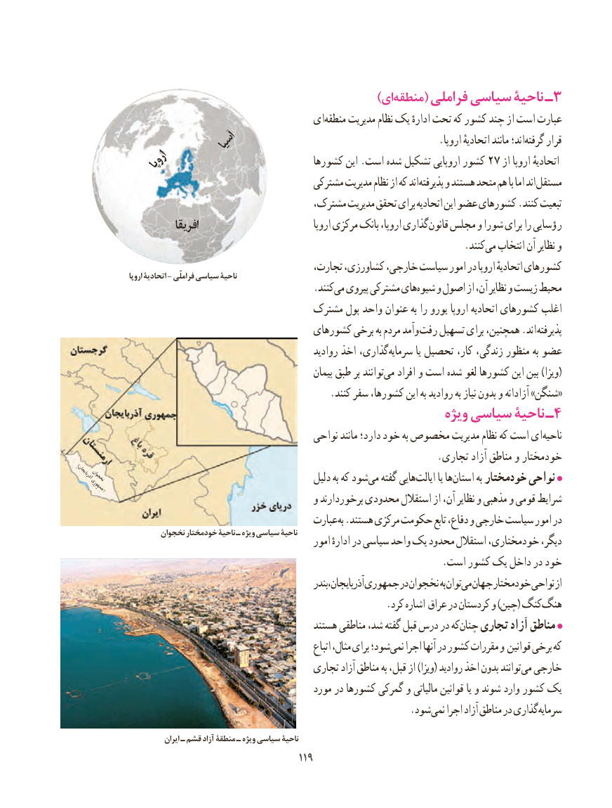

# PDF page 127

)ایمنطقه‌     ( فراملی سیاسی ناحیۀ ـ3
                                          ایمنطقه‌     مدیریت نظام یک ادارهٔ تحت که کشور چند از است عبارت
                   آسیا    .‌اروپا اتحادیهٔ مانند اند؛گرفته قرار
            اروپا                            کشورها این .است شده تشکیل اروپایی کشور 27 از اروپا اتحادیهٔ
                                               مشترکی مدیریت نظام از که اند پذیرفته و هستند متحد هم با اما اند مستقل
                                           مشترک، مدیریت تحقق برای اتحادیه این عضو کشورهای .کنند تبعیت
                         افریقا                                اروپا مرکزی بانک اروپا، گذاریقانون‌   مجلس و شورا برای را رؤسایی
                                 .‌کنندمی انتخاب آن نظایر و
                                                 تجارت، کشاورزی، خارجی، سیاست امور در اروپا اتحادیهٔ کشورهای                    اروپا اتحادیۀ - فراملّی سیاسی ناحیۀ
                                                 .کنندمی‌  پیروی مشترکی هایشیوه‌   و اصول از آن، نظایر و زیست محیط
                                        مشترک پول واحد عنوان به را یورو اروپا اتحادیه کشورهای اغلب
                                           کشورهای برخی به مردم وآمد ‌رفت تسهیل برای همچنین، .اند پذیرفته
                                                          روادید اخذ گذاری،سرمایه‌         یا تحصیل کار، زندگی، منظور به عضو
                                                             پیمان طبق بر توانندمی‌(افراد و است شده لغو کشورها این بین )ویزا
                                                    .کنند سفر کشورها، این به روادید به نیاز بدون و آزادانه »شنگن«
                                                              ویژه سیاسی ناحیۀ ـ4
                                                نواحی مانند دارد؛ خود به مخصوص مدیریت نظام که است ای‌ناحیه
                                                                          .تجاری آزاد مناطق و خودمختار
)(آذربایجانجمهورینخجوان                                                دلیل به که شودمی‌   گفته هاییایالت‌       یا هااستان‌       به خودمختار نواحی
                                                 و برخوردارند محدودی استقالل از آن، نظایر و مذهبی و قومی شرایط
                                                 عبارت به .هستند مرکزی حکومت تابع دفاع، و خارجی سیاست امور در
                     نخجوان خودمختار ناحیۀ ـ ویژه سیاسی ناحیۀ                                                        امور ادارهٔ در سیاسی واحد یک محدود استقالل خودمختاری، دیگر،
                                                                           .است کشور یک داخل در خود
                                                                  آذربایجان،بندر جمهوری در نخجوان به توانمی‌ جهان خودمختار نواحی از
    .‌کرد اشاره عراق در کردستان و )چین( کنگهنگ
                                                  هستند مناطقی شد، گفته قبل درس در کهچنان‌   تجاری آزاد مناطق
                                                                    اتباع مثال، برای شود؛نمی‌   اجرا آنها در کشور مقررات و قوانین برخی که
                                               تجاری آزاد مناطق به قبل، از )ویزا( روادید اخذ بدون توانند می خارجی
                                                    مورد در کشورها گمرکی و مالیاتی قوانین یا و شوند وارد کشور یک
                             . شودنمی اجرا آزاد مناطق در گذاری سرمایه

                             ایران ـ قشم آزاد منطقۀ ـ ویژه سیاسی ناحیۀ
                                             119119

