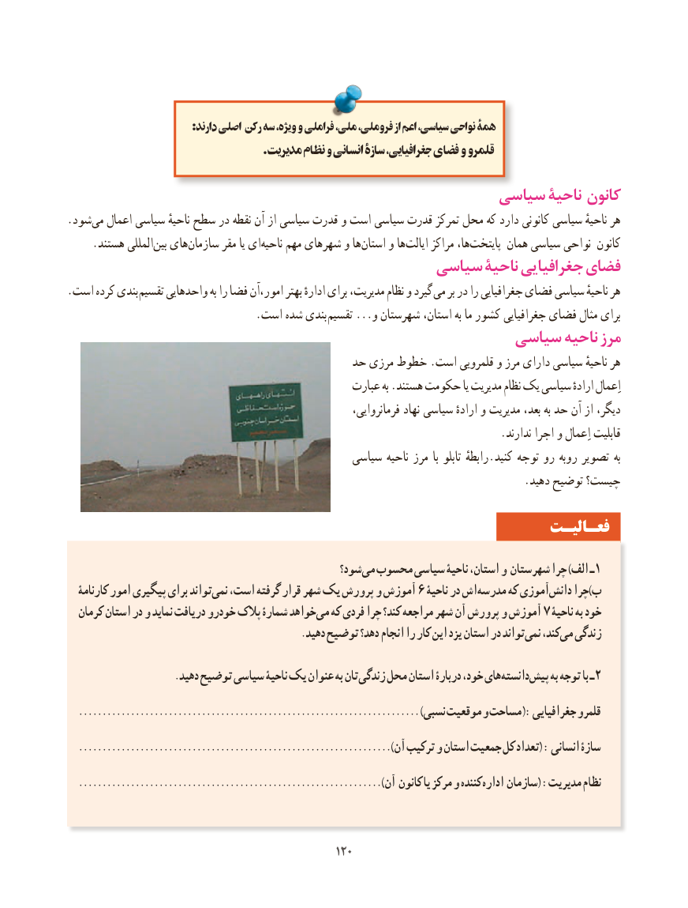

# PDF page 128

: دارند اصلی رکن سه ویژه، و فراملی ملی، فروملی، از اعم سیاسی، نواحی همۀ
                                              .مدیریت نظام و انسانی سازۀ جغرافیایی، فضای و قلمرو
                                              سیاسی ناحیۀ کانون
.شود‌می اعمال سیاسی ناحیهٔ سطح در نقطه آن از سیاسی قدرت و است سیاسی قدرت تمرکز محل که دارد کانونی سیاسی ناحیهٔ هر
 .‌هستند المللیبین های ‌سازمان مقر یا ایناحیه‌    مهم شهرهای و هااستان‌    و هاایالت‌     مراکز ها،پایتخت‌      همان سیاسی نواحی کانون
                                       سیاسی ناحیۀ جغرافیایی فضای
. است کرده بندی تقسیم واحدهایی به را فضا امور،آن بهتر ادارهٔ برای مدیریت، نظام و گیرد می بر در را جغرافیایی فضای سیاسی ناحیهٔ هر
     . است شده بندی تقسیم ...و شهرستان استان، به ما کشور جغرافیایی فضای مثال برای
                                               سیاسی ناحیه مرز
                                         حد مرزی خطوط .است قلمرویی و مرز دارای سیاسی ناحیهٔ هر
                                                   عبارت به .هستند حکومت یا مدیریت نظام یک سیاسی ارادهٔ اِعمال
                                                                  فرمانروایی، نهاد سیاسی ارادهٔ و مدیریت بعد، به حد آن از دیگر،
                                                                               .ندارند اجرا و اِعمال قابلیت
                                                سیاسی ناحیه مرز  با تابلو رابطهٔ . کنید توجه رو روبه تصویر به
                                                                                   .دهید توضیح چیست؟

                                                                 فعـالیـت

                                                 شود؟می‌  محسوب سیاسی ناحیۀ استان، و شهرستان چرا )الف ـ 1
   کارنامۀ امور پیگیری برای تواندنمی‌  است، گرفته قرار شهر یک پرورش و آموزش 6 ناحیۀ در اش مدرسه که آموزیدانش‌    چرا)ب
  کرمان استان در و نماید دریافت خودرو پالک شمارۀ خواهدمی‌  که فردی چرا کند؟ مراجعه شهر آن پرورش و آموزش 7 ناحیۀ به خود
  .‌دهید توضیح دهد؟ انجام را کار این یزد استان در تواندنمی کند،می‌  زندگی

 . دهید توضیح سیاسی ناحیۀ یک عنوان به تانزندگی محل استان دربارۀ خود، هایدانسته‌    پیش‌    به توجه با ـ 2
  ........................................................................ )نسبی موقعیت و مساحت :( جغرافیایی قلمرو
  )..................................................................آن ترکیب و استان جمعیت کل تعداد( : انسانی سازۀ
  )................................................................‌آن کانون یا مرکز و کننده اداره سازمان( :مدیریت نظام

                                                120120

