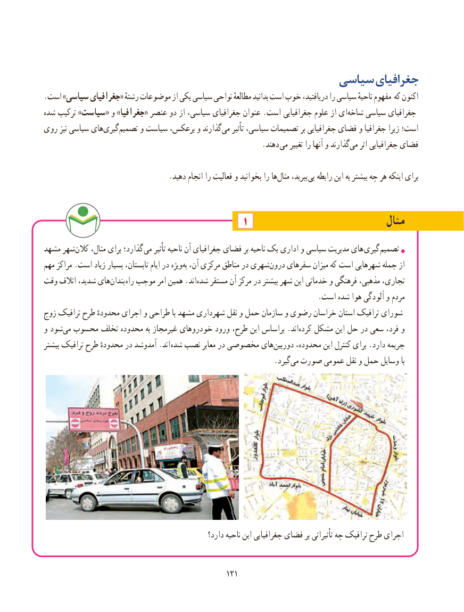

# PDF page 129

سیاسی جغرافیای
.است »سیاسی جغرافیای« رشتهٔ موضوعات از یکی سیاسی نواحی مطالعهٔ بدانید است خوب دریافتید، را سیاسی ناحیهٔ مفهوم که اکنون
شده ترکیب »سیاست« و »جغرافیا« عنصر دو از سیاسی، جغرافیای عنوان .است جغرافیایی علوم از ایشاخه‌    سیاسی جغرافیای
روی نیز سیاسی های‌گیری ‌تصمیم و سیاست برعکس، و گذارندمی‌    تأثیر سیاسی، تصمیمات بر جغرافیایی فضای و جغرافیا زیرا است؛
                       . دهند می تغییر را آنها و گذارندمی‌   اثر جغرافیایی فضای

  .‌دهید انجام را فعالیت و بخوانید را هامثال ببرید، پی رابطه این به بیشتر چه هر اینکه برای

                                                  1                              مثال
مشهد شهر ‌کالن مثال، برای گذارد؛ می تأثیر ناحیه آن جغرافیای فضای بر ناحیه یک اداری و سیاسی مدیریت های  گیری تصمیم
مهم مراکز .است زیاد بسیار تابستان، ایام در ویژه‌به آن، مرکزی مناطق در شهری‌درون سفرهای میزان که است شهرهایی جمله از
وقت اتالف شدید، های‌بندان راه موجب امر همین .اندشده‌   مستقر آن مرکز در بیشتر شهر این خدماتی و فرهنگی مذهبی، تجاری،
                                                                          .است شده هوا آلودگی و مردم
زوج ترافیک طرح محدودهٔ اجرای و طراحی با مشهد شهرداری نقل و حمل سازمان و رضوی خراسان استان ترافیک شورای
و شودمی‌  محسوب تخلف محدوده به غیرمجاز خودروهای ورود طرح، این براساس .اند ‌کرده مشکل این حل در سعی فرد، و
بیشتر ترافیک طرح محدودهٔ در آمدوشد .اند شده نصب معابر در مخصوصی های ‌دوربین محدوده، این کنترل برای .دارد جریمه
                         .‌گیردمی صورت عمومی نقل و حمل وسایل با

                                                    دارد؟ ناحیه این جغرافیایی فضای بر تأثیراتی چه ترافیک طرح اجرای

                                                 121121

