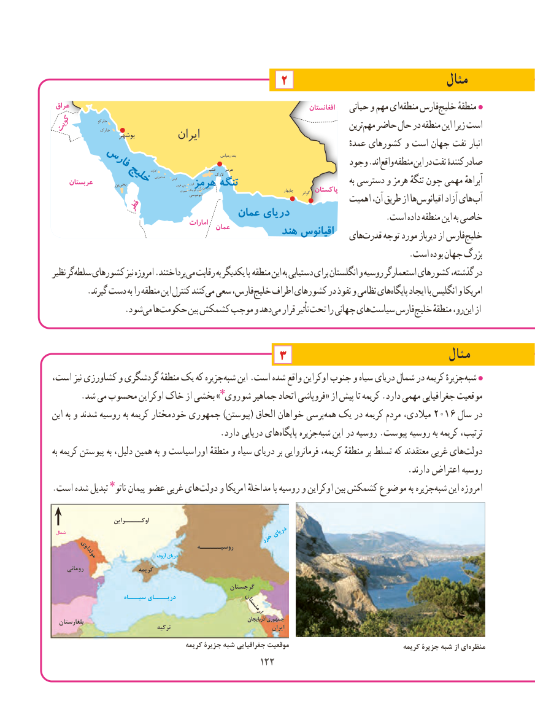

# PDF page 130

مثال۲
 عراق                                                                                  افغانستان    حیاتی و مهم ای منطقه فارسخلیج‌     منطقهٔ
                        خارکوکویت          خارک                                                                      ترین مهم حاضر حال در منطقه این زیرا است
                    بوشهر                            ایران                                                                                          عمدهٔ کشورهای و است جهان نفت انبار
                                                                                    بندرعباس
                                                                                    هرمز                         وجود .اند واقع منطقه این در نفت کنندهٔ صادر      فارس             الوان                       قشم
                                                                        الرک                                                                                هندورابی   کیش
                                                                                                          فرور                                                                                                       بنی     عربستان         بحرینخلیج                فرور
                                                                     کوچک                                                                          سیری                          هرمز تنببزرگ تنب  تنگه                            چابهار     گواتر پاکستان    به دسترسی و هرمز تنگهٔ چون مهمی آبراههٔ                                                                          ابوموسی                                                                    اهمیت آن، طریق از ها اقیانوس آزاد های آب            قطر                                  عمان دریای                                                                              .است داده منطقه این به خاصی                                           امارات
                                             عمان          هند اقیانوس                                                                هایقدرت‌    توجه مورد دیرباز از فارسخلیج‌
                                                                                   .است بوده جهان بزرگ
نظیر گرسلطه‌   کشورهای نیز امروزه .پرداختندمی‌  رقابت به یکدیگر با منطقه این به دستیابی برای انگلستان و روسیه استعمارگر کشورهای گذشته، در
 .‌گیرند دست به را منطقه این کنترل کنندمی سعی فارس،خلیج‌    اطراف کشورهای در نفوذ و نظامی هایپایگاه‌     ایجاد با انگلیس و امریکا
       .‌شودمی هاحکومت‌       بین کشمکش‌     موجب و دهد می قرار تأثیر تحت را جهانی هایسیاست‌     فارسخلیج‌     منطقهٔ رو،این‌   از

      مثال۳
،جزیرهاست نیز کشاورزی و گردشگری منطقهٔ یک که     شبه‌   این .است شده واقع اوکراین جنوب و سیاه دریای شمال در کریمه جزیرهٔشبه‌
       .شد می محسوب اوکراین خاک از بخشی »شوروی٭ جماهیر اتحاد فروپاشی« از پیش تا کریمه .دارد مهمی جغرافیایی موقعیت
این به و شدند روسیه به کریمه خودمختار جمهوری )پیوستن( الحاق خواهان پرسیهمه‌  یک در کریمه مردم میالدی، 2016 سال در
                                       .دارد دریایی هایپایگاه‌     جزیرهشبه‌   این در روسیه .پیوست روسیه به کریمه ترتیب،
به کریمه پیوستن به دلیل، همین به و اوراسیاست منطقهٔ و سیاه دریای بر فرمانروایی کریمه، منطقهٔ بر تسلط که معتقدند غربی های‌دولت
                                                                                   .دارند اعتراض روسیه
.‌است شده تبدیل ناتو٭ پیمان عضو غربی هایدولت و امریکا مداخلهٔ با روسیه و اوکراین بین کشمکش موضوع به جزیره ‌شبه این امروزه

                     اوکـــــراین
 شمال                                                         دریای                                          خزر
                                            روسیــــــه        مولداوی                       آزوف دریای
     رومانی                  کریمه
                                                   گرجستان
                       سیـــاه دریــــای                      ارمنستان
  بلغارستان                                                                           آذربایجانجمهوری                                     ترکیه                                        ایران
                                        کریمه جزیرۀ شبه جغرافیایی موقعیت                                  کریمه جزیرۀ شبه از ای منظره
                                           122122

