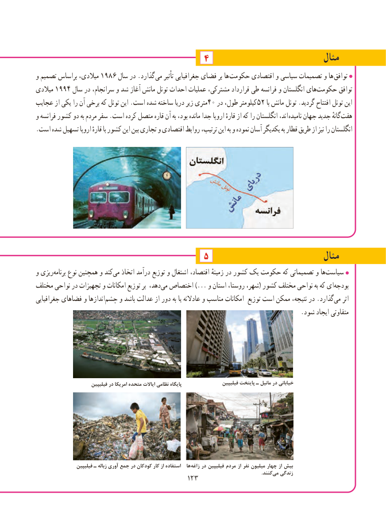

# PDF page 131

مثال۴
و تصمیم براساس میالدی، 1986 سال در .گذارد می تأثیر جغرافیایی فضای بر ها  حکومت اقتصادی و سیاسی تصمیمات و ها  توافق
میالدی 1994 سال در سرانجام، و شد آغاز مانش تونل احداث عملیات مشترکی، قرارداد طی فرانسه و انگلستان هایحکومت‌        توافق
عجایب از یکی را آن برخی که تونل این .است شده ساخته دریا زیر متری40 در طول، کیلومتر52 با مانش تونل .گردید افتتاح تونل این
و فرانسه کشور دو به مردم سفر .است کرده متصل قاره آن به بود، مانده جدا اروپا قارهٔ از که را انگلستان اند، نامیده جهان جدید گانهٔ‌هفت
.است شده تسهیل اروپا قارهٔ با کشور این بین تجاری و اقتصادی روابط ترتیب، این به و نموده آسان یکدیگر به قطار طریق از نیز را انگلستان

                                    5                              مثال                                                                                                                                                                                                                                                                         ا
و ریزی‌برنامه نوع همچنین و کندمی‌   اتخاذ درآمد توزیع و اشتغال اقتصاد، زمینهٔ در کشور یک حکومت که تصمیماتی و ها ‌سیاست
مختلف نواحی در تجهیزات و امکانات توزیع بر دهد،می‌  اختصاص ...) و استان روستا، شهر،( کشور مختلف نواحی به که ای‌بودجه
جغرافیایی فضاهای و اندازها‌چشم و باشد عدالت از دور به یا عادالنه و مناسب امکانات توزیع است ممکن نتیجه، در .گذاردمی‌   اثر
                                                                                      .شود ایجاد متفاوتی

                        فیلیپین در امریکا متحده ایاالت نظامی پایگاه                  فیلیپین پایتخت ـ مانیل در خیابانی

                  فیلیپین ـ زباله آوری جمع در کودکان کار از استفاده   ها‌زاغه در فیلیپین مردم از نفر میلیون چهار از بیش
                                     .‌کنندمی زندگی                                         123123

