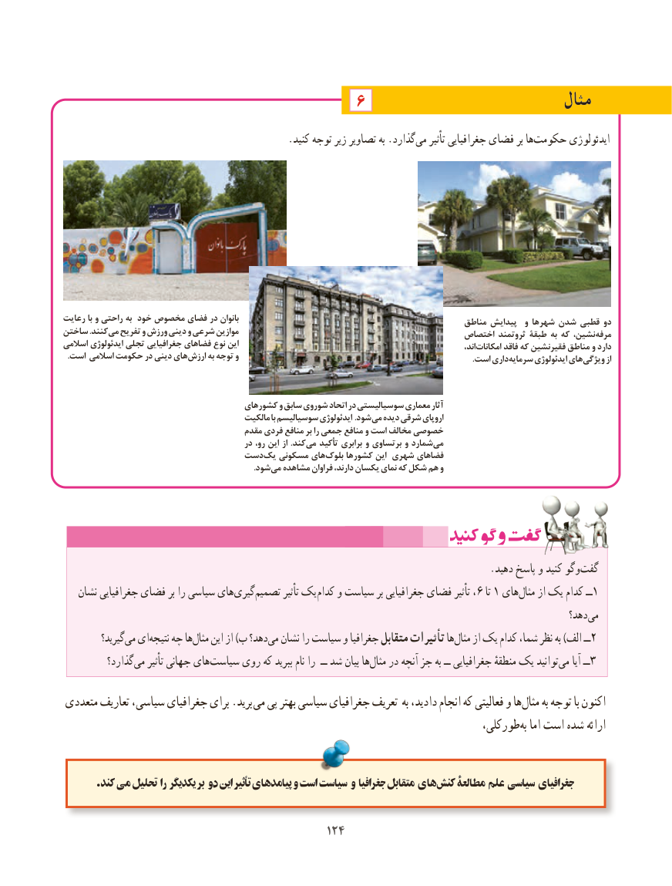

# PDF page 132

6                              مثال
                                             .کنید توجه زیر تصاویر به .گذاردمی‌   تأثیر جغرافیایی فضای بر هاحکومت‌       ایدئولوژی

رعایت با و راحتی به خود مخصوص فضای در بانوان                                                  مناطق پیدایش  و شهرها شدن قطبی دو
ساختن .کنند می تفریح و ورزش دینی و شرعی موازین                                            اختصاص ثروتمند طبقۀ به که نشین، مرفه
اسالمی ایدئولوژی تجلی جغرافیایی فضاهای نوع این                                                                             اند، امکانات فاقد که فقیرنشین مناطق و دارد
. است اسالمی حکومت در دینی هایارزش به توجه و            . است داریسرمایه ایدئولوژی های ویژگی از

                                      کشورهای و سابق شوروی اتحاد در سوسیالیستی معماری آثار
                                          مالکیت با سوسیالیسم ایدئولوژی .شود می دیده شرقی اروپای
                                        مقدم فردی منافع بر را جمعی منافع و است مخالف خصوصی
                                            در رو، این از .کند می تأکید برابری و برتساوی و شمارد می
                            دست یک مسکونی های بلوک کشورها این شهری فضاهای
                    . شودمی مشاهده فراوان دارند، یکسان نمای که شکل هم و

                                                                                     .دهید پاسخ و کنید وگوگفت‌
   نشان جغرافیایی فضای بر را سیاسی های ‌گیری‌تصمیم تأثیر یک  کدام و سیاست بر جغرافیایی فضای تأثیر ،6 تا 1 های ‌مثال از یک کدام ــ1
                                                                                                            دهد؟‌می
          گیرید؟می‌  اینتیجه‌   چه هامثال‌    این از )ب دهد؟می‌  نشان را سیاست و جغرافیا متقابل تأثیرات هامثال‌    از یک کدام شما، نظر به )الف ــ2
          گذارد؟ ‌می تأثیر جهانی هایسیاست‌     روی که ببرید نام را  ــ شد بیان هامثال‌   در آنچه جز به ــ جغرافیایی منطقهٔ یک توانیدمی‌    آیا ــ3

متعددی تعاریف سیاسی، جغرافیای برای .برید  می پی بهتر سیاسی جغرافیای تعریف به دادید، انجام که فعالیتی و ها‌مثال به توجه با اکنون
                                                                             طورکلی،‌به اما است شده ارائه

        .کند ‌می تحلیل را یکدیگر بر دو این‌    تأثیر پیامدهای و است سیاست و جغرافیا متقابل هایکنش‌    مطالعۀ علم سیاسی جغرافیای

                                           124124

