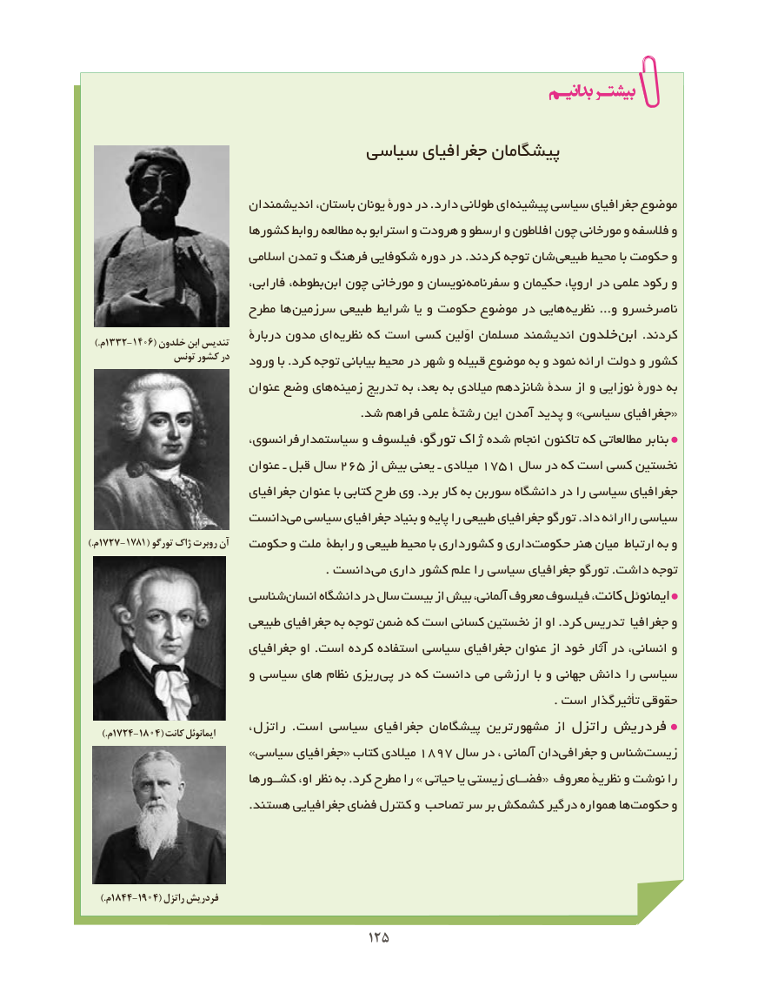

# PDF page 133

سیاسی جغرافیای پیشگامان

                         اندیشمندان باستان، یونان دورۀ در .دارد طوالنی ای پیشینه سیاسی جغرافیای موضوع
                        کشورها روابط مطالعه به استرابو و هرودت و ارسطو و افالطون چون مورخانی و فالسفه و
                           اسالمی تمدن و فرهنگ شکوفایی دوره در .کردند توجه شان طبیعی محیط با حکومت و
                               فارابی، بطوطه،  ابن چون مورخانی و نویسان سفرنامه و حکیمان اروپا، در علمی رکود و
                        مطرح ها سرزمین طبیعی شرایط یا و حکومت موضوع در هایی  نظریه ...و ناصرخسرو
                              دربارۀ مدون ای  نظریه که است کسی اوّلین مسلمان اندیشمند خلدون ابن .کردند  .)م1332-1406( خلدون ابن تندیس
               تونس کشور در                         ورود با .کرد توجه بیابانی محیط در شهر و قبیله موضوع به و نمود ارائه دولت و کشور
                          عنوان وضع های  زمینه تدریج به بعد، به میالدی شانزدهم سدۀ از و نوزایی دورۀ به
                                                                     .شد فراهم علمی رشتۀ این آمدن پدید و »سیاسی جغرافیای«
                         سیاستمدارفرانسوی، و فیلسوف تورگو، ژاک شده انجام تاکنون که مطالعاتی بر بنا
                          عنوان ـ قبل سال 265 از بیش یعنی ـ میالدی 1751 سال در که است کسی نخستین
                           جغرافیای عنوان با کتابی طرح وی .برد کار به سوربن دانشگاه در را سیاسی جغرافیای
                     دانستمی‌  سیاسی جغرافیای بنیاد و پایه را طبیعی جغرافیای تورگو .داد راارائه سیاسی
).م1727-1781( تورگو ژاک روبرت آن   حکومت و ملت رابطۀ و طبیعی محیط با کشورداری و داری ‌حکومت هنر میان ارتباط به و
          . دانست می داری کشور علم را سیاسی جغرافیای تورگو .داشت توجه
                      شناسیانسان‌     دانشگاه در سال بیست از بیش آلمانی، معروف فیلسوف کانت، ایمانوئل
                         طبیعی جغرافیای به توجه ضمن که است کسانی نخستین از او .کرد تدریس جغرافیا و
                           جغرافیای او .است کرده استفاده سیاسی جغرافیای عنوان از خود آثار در انسانی، و
                          و سیاسی های نظام ریزی  پی در که دانست می ارزشی با و جهانی دانش را سیاسی
                                                                                                                      . است تأثیرگذار حقوقی
                          راتزل،  . است سیاسی جغرافیای پیشگامان مشهورترین از راتزل فردریش     ).م1724-1804( کانت ایمانوئل
                         »سیاسی جغرافیای« کتاب میالدی 1897 سال در ، آلمانی دان ‌جغرافی و شناس‌زیست
                           کشــورها او، نظر به .کرد مطرح را » حیاتی یا زیستی فضــای« معروف نظریۀ و نوشت را
 .‌هستند جغرافیایی فضای کنترل و تصاحب سر بر کشمکش درگیر همواره ها حکومت و

    ).م1844-1904( راتزل فردریش

                                       125125

