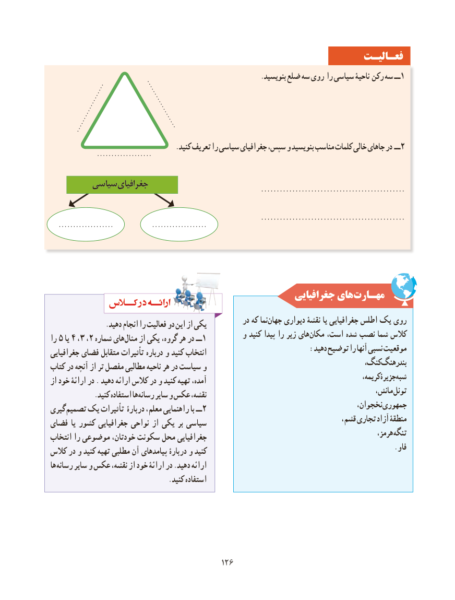

# PDF page 134

فعـالیـت
                                                              .بنویسید ضلع سه روی را سیاسی ناحیۀ رکن سه ــ 1
                                           ......................................         ......................................
                                     .کنید تعریف را سیاسی جغرافیای سپس، و بنویسید مناسب کلمات خالی جاهای در ــ2                ......................................

        سیاسی جغرافیای                                                                   ..............................................

                                                                   ..............................................   ......................................             ......................................

                                                      جغرافیایی هایمهـارت‌
                                                       در که نماجهان‌    دیواری نقشۀ یا جغرافیایی اطلس یک روی                .دهید انجام را فعالیت دو این از یکی
                                             و کنید پیدا را زیر هایمکان‌    است، شده نصب شما کالسرا 5 یا 4 ،3 ،2 شماره های مثال از یکی گروه، هر در ــ 1
                                                             :دهید توضیح را آنها نسبی موقعیتجغرافیایی فضای متقابل تأثیرات درباره و کنید انتخاب
                                                                          کنگ،بندرهنگ‌کتاب در آنچه از تر مفصل مطالبی ناحیه هر در سیاست و
                                                                                                      کریمه،جزیرۀشبه‌از خود ارائۀ در . دهید ارائه کالس در و کنید تهیه آمده،
                                                                                            مانش، تونل  . کنید استفاده هارسانه سایر و عکس نقشه،
                                                                                   نخجوان،جمهوریگیری تصمیم یک تأثیرات دربارۀ معلم، راهنمایی با ــ2
                                                                               قشم، تجاری آزاد منطقۀفضای یا کشور جغرافیایی نواحی از یکی بر سیاسی
                                                                                                    هرمز، تنگهانتخاب را موضوعی خودتان، سکونت محل جغرافیایی
                                                                              . و فاکالس در و کنید تهیه مطلبی آن پیامدهای دربارۀ و کنید
ها رسانه سایر و عکس نقشه، از خود ارائۀ در .دهید ارائه
                                   .کنید استفاده

                                         126126

