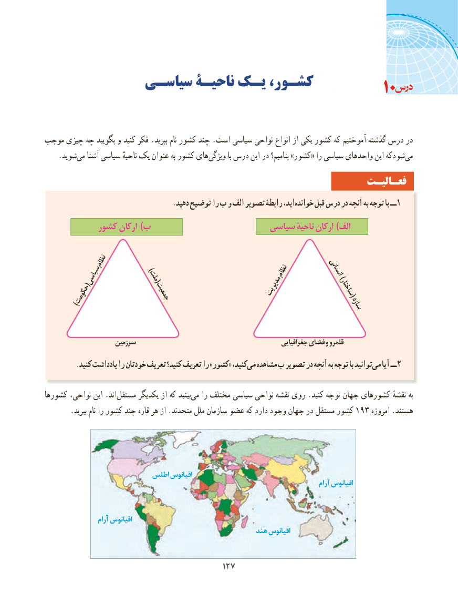

# PDF page 135

سیاسـی ناحیـة یـک کشـور،                                                  10

موجب چیزی چه بگویید و کنید فکر .ببرید نام کشور چند .است سیاسی نواحی انواع از یکی کشور که آموختیم گذشته درس در
    .شوید‌می آشنا سیاسی ناحیهٔ یک عنوان به کشور هایویژگی‌         با درس این در بنامیم؟ »کشور« را سیاسی واحدهای این شودکهمی‌
                                                                 فعـالیـت
                                      .دهید توضیح را ب و الف تصویر رابطۀ اید، خوانده قبل درس در آنچه به توجه با ــ 1
           کشور ارکان )ب                       سیاسی ناحیۀ ارکان )الف

           نظام        )                                                    نظام           انسانی                  ملت(   (سیاسی                                                           مدیریت    )ساختار(                          جمعیت  )حکومت                                                                    سازه

                    سرزمین                                                 جغرافیایی فضای و قلمرو
.‌کنید یادداشت را خودتان تعریف کنید؟ تعریف را »کشور« کنید،می مشاهده ب تصویر در آنچه به توجه با توانیدمی‌   آیا ــ 2

کشورها نواحی، این .اند‌مستقل یکدیگر از که بینیدمی‌   را مختلف سیاسی نواحی نقشه روی .کنید توجه جهان کشورهای نقشهٔ به
.193ببرید نام را کشور چند قاره هر از .متحدند ملل سازمان عضو که دارد وجود جهان در مستقل کشور      امروزه .هستند

                         اطلس اقیانوس
                                                                                                  آرام اقیانوس

                   آرام اقیانوس
                                                      هند اقیانوس

                                         127127

