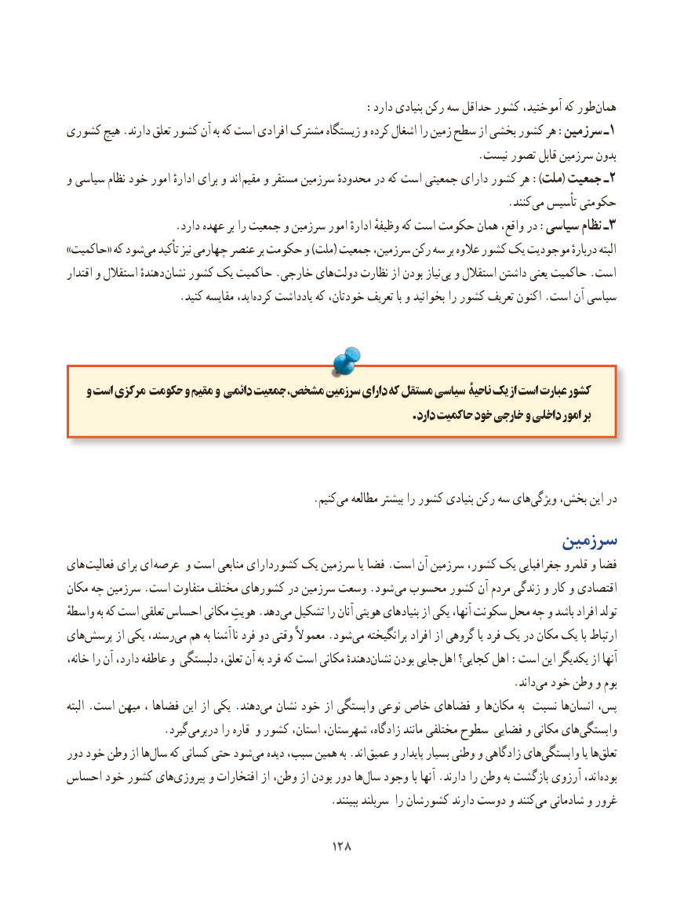

# PDF page 136

:دارد بنیادی رکن سه حداقل کشور آموختید، که طورهمان‌
کشوری هیچ .دارند تعلق کشور آن به که است افرادی مشترک زیستگاه و کرده اشغال را زمین سطح از بخشی کشور هر :سرزمین ـ 1
                                                                           .نیست تصور قابل سرزمین بدون
و سیاسی نظام خود امور ادارهٔ برای و اند مقیم و مستقر سرزمین محدودهٔ در که است جمعیتی دارای کشور هر ):ملت( جمعیت ـ2
                                                                                .کنند  می تأسیس حکومتی
.3دارد عهده بر را جمعیت و سرزمین امور ادارهٔ وظیفهٔ که است حکومت همان واقع، در :سیاسی نظام ـ
»حاکمیت« که شودمی‌   تأکید نیز چهارمی عنصر بر حکومت و )ملت( جمعیت سرزمین، رکن سه بر عالوه کشور یک موجودیت دربارهٔ البته
اقتدار و استقالل دهندهٔ نشان کشور یک حاکمیت .خارجی های‌دولت نظارت از بودن نیاز بی و استقالل داشتن یعنی حاکمیت .است
   .‌کنید مقایسه اید،کرده یادداشت که خودتان، تعریف با و بخوانید را کشور تعریف اکنون .است آن سیاسی

   و است مرکزی حکومت و مقیم و دائمی جمعیت ، مشخص سرزمین دارای که مستقل سیاسی ناحیۀ یک از است عبارت کشور
                                                                           .دارد حاکمیت خود خارجی و داخلی امور بر

                   .‌کنیم می مطالعه بیشتر را کشور بنیادی رکن سه هایویژگی‌    بخش، این در
                                                    سرزمین
های فعالیت برای ای عرصه و است منابعی کشوردارای یک سرزمین یا فضا .است آن سرزمین کشور، یک جغرافیایی قلمرو و فضا
مکان چه سرزمین .است متفاوت مختلف کشورهای در سرزمین وسعت .شود  می محسوب کشور آن مردم زندگی و کار و اقتصادی
واسطهٔ به که است تعلقی احساس مکانی هویتِ .دهد‌می تشکیل را آنان هویتی بنیادهای از یکی آنها، سکونت محل چه و باشد افراد تولد
های‌پرسش از یکی رسند،می‌  هم به آشنا نا فرد دو وقتی معموالً .شود ‌می برانگیخته افراد از گروهی یا فرد یک در مکان یک با ارتباط
خانه، را آن دارد، عاطفه و دلبستگی تعلق، آن به فرد که است مکانی دهندهٔ ‌نشان بودن جایی  اهل کجایی؟ اهل :است این یکدیگر از آنها
                                   .‌داند می خود وطن و بوم
البته .است میهن ، فضاها این از یکی .دهند‌می نشان خود از وابستگی نوعی خاص فضاهای و ها‌مکان به نسبت ها‌انسان پس،
       .‌گیرد دربرمی را قاره و کشور استان، شهرستان، زادگاه، مانند مختلفی سطوح فضایی و مکانی هایوابستگی‌
دور خود وطن از ها‌سال که کسانی حتی شودمی‌   دیده سبب، همین به .اند عمیق و پایدار بسیار وطنی و زادگاهی های‌وابستگی یا ها‌تعلق
احساس خود کشور های‌پیروزی و افتخارات از وطن، از بودن دور ها‌سال وجود با آنها .دارند را وطن به بازگشت آرزوی اند، ‌بوده
   .‌ببینند سربلند را کشورشان دارند دوست و کنندمی شادمانی و غرور

                                        128128

