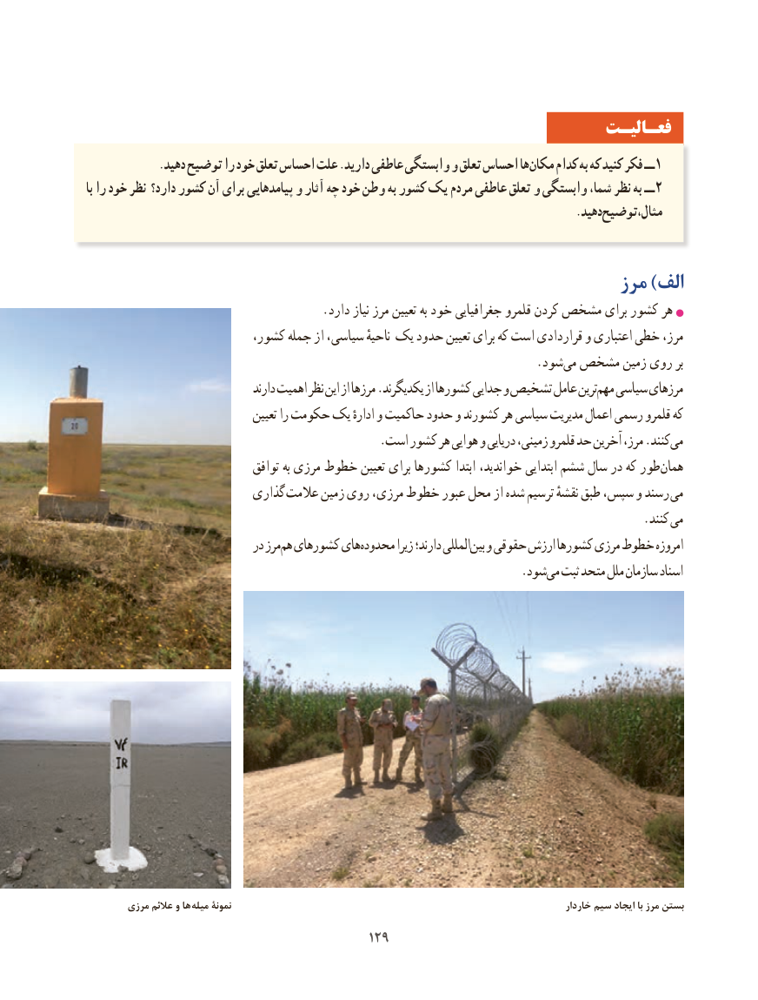

# PDF page 137

فعـالیـت
             .دهید توضیح را خود تعلق احساس علت .دارید عاطفی وابستگی و تعلق احساس هامکان‌    کدام به که کنید فکر ــ1
با را خود نظر دارد؟ کشور آن برای پیامدهایی و آثار چه خود وطن به کشور یک مردم عاطفی تعلق و وابستگی شما، نظر به ــ 2
                                                                                       .دهیدمثال،توضیح

                                                           مرز )الف
                                       .دارد نیاز مرز تعیین به خود جغرافیایی قلمرو کردن مشخص برای کشور هر
  ،مرز،کشور جمله از سیاسی، ناحیهٔ یک حدود تعیین برای که است قراردادی و اعتباری خطی
                              .‌شود می مشخص زمین روی بر
                                    دارند اهمیت نظر این از مرزها .یکدیگرند از کشورها جدایی و تشخیص عامل ترینمهم‌  سیاسی مرزهای
                                  تعیین را حکومت یک ادارهٔ و حاکمیت حدود و کشورند هر سیاسی مدیریت اعمال رسمی قلمرو که
                                                .است کشور هر هوایی و دریایی زمینی، قلمرو حد آخرین مرز، .کنندمی‌
                               توافق به مرزی خطوط تعیین برای کشورها ابتدا خواندید، ابتدایی ششم سال در که طور ‌همان
                          گذاری عالمت زمین روی مرزی، خطوط عبور محل از شده ترسیم نقشهٔ طبق سپس، و رسند می
                                      . کنند می
                             در مرزهم‌ کشورهای هایمحدوده‌        زیرا دارند؛ المللیبین‌  و حقوقی ارزش کشورها مرزی خطوط امروزه
                              .‌شودمی ثبت متحد ملل سازمان اسناد

        مرزی عالئم و ها میله نمونۀ                                                                             خاردار سیم ایجاد با مرز بستن
                                         129129

