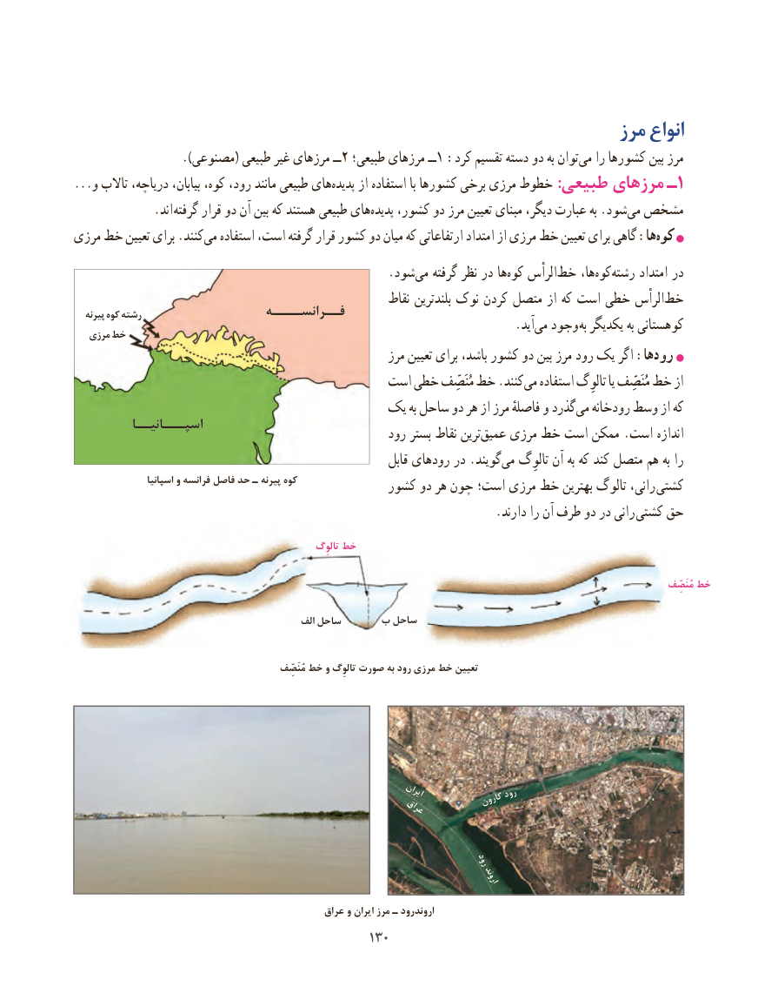

# PDF page 138

مرز انواع
  ).2مصنوعی( طبیعی غیر مرزهای ــ  طبیعی؛ مرزهای ــ1 :کرد تقسیم دسته دو به توانمی‌   را کشورها بین مرز
...و تاالب دریاچه، بیابان، کوه، رود، مانند طبیعی هایپدیده‌     از استفاده با کشورها برخی مرزی خطوط :طبیعی مرزهای ـ 1
             .اند گرفته قرار دو آن بین که هستند طبیعی هایپدیده‌    کشور، دو مرز تعیین مبنای دیگر، عبارت به .شودمی‌ مشخص
مرزی خط تعیین برای .کنندمی‌   استفاده است، گرفته قرار کشور دو میان که ارتفاعاتی امتداد از مرزی خط تعیین برای گاهی :هاکوه‌
                                                    .شود ‌می گرفته نظر در ها‌کوه الرأس‌خط ها،کوه‌    ‌رشته امتداد در
                                                          نقاط بلندترین نوک کردن متصل از که است خطی الرأسخط‌   پیرنه کوه رشته                   فــرانســــه                                                                         .آید‌می وجود به یکدیگر به کوهستانی   مرزی خط
                                                         مرز تعیین برای باشد، کشور دو بین مرز رود یک اگر :هارود‌
                                        است خطی مُنَصِّف‌خط .کنندمی‌   استفاده تالوِگ یا مُنَصِّف خط‌    از
                                  یک به ساحل دو هر از مرز فاصلهٔ و گذرد ‌می رودخانه وسط از که
          اسپـــانیــا                                                    رود بستر نقاط ترینعمیق‌    مرزی خط است ممکن .است اندازه
                                                               قابل رودهای در .گویند‌می تالوِگ آن به که کند متصل هم به را
                   اسپانیا و فرانسه فاصل حد ـ پیرنه کوه             کشور دو هر چون است؛ مرزی خط بهترین تالوگ رانی،  کشتی
                                                                     .دارند را آن طرف دو در رانی کشتی حق
                                                             تالوِگ خط
                                         ب ساحل
                                                                                                                                                                                         مُنَصِّف خط

                                                 الف ساحل     ب ساحل

                                                                مُنَصِّف خط و تالوِگ صورت به رود مرزی خط تعیین

                                                                   ایران             رود                                                                                کارون                                                     عراق

                                                       رود
                                                                                    اروند

                                                  عراق و ایران مرز ـ اروندرود
                                             130130

