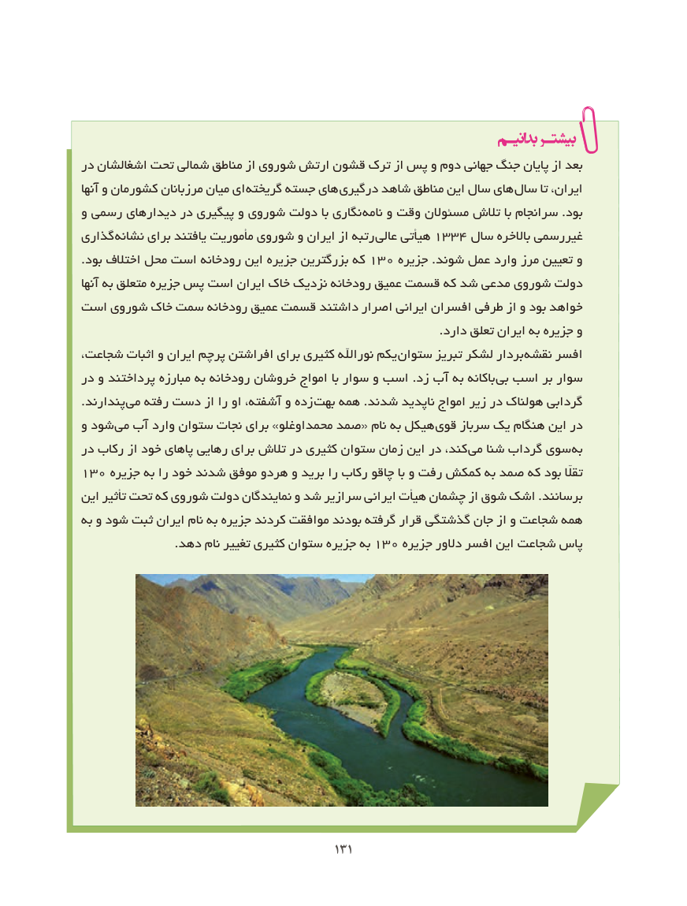

# PDF page 139

در اشغالشان تحت شمالی مناطق از شوروی ارتش قشون ترک از پس و دوم جهانی جنگ پایان از بعد
آنها و کشورمان مرزبانان میان ای  گریخته جسته های  درگیری شاهد مناطق این سال های  سال تا ایران،
و رسمی دیدارهای در پیگیری و شوروی دولت با نگاری نامه و وقت مسئوالن تالش با سرانجام .بود
گذاری  نشانه برای یافتند مأموریت شوروی و ایران از رتبه  عالی١غیررسمیهیأتی ٤٣٣ سال باالخره
.بود اختالف محل است رودخانه این جزیره بزرگترین که ١و٠٣ جزیره .شوند عمل وارد مرز تعیین
آنها به متعلق جزیره پس است ایران خاک نزدیک رودخانه عمیق قسمت که شد مدعی شوروی دولت
است شوروی خاک سمت رودخانه عمیق قسمت داشتند اصرار ایرانی افسران طرفی از و بود خواهد
                                                                                            .دارد تعلق ایران به جزیره و
شجاعت، اثبات و ایران پرچم افراشتن برای کثیری نوراهلل یکم ستوان تبریز لشکر بردار  نقشه افسر
در و پرداختند مبارزه به رودخانه خروشان امواج با سوار و اسب .زد آب به باکانه بی اسب بر سوار
.پندارند می رفته دست از را او آشفته، و زده  بهت همه .شدند ناپدید امواج زیر در هولناک گردابی
و شود  می آب وارد ستوان نجات برای »محمداوغلو صمد« نام به هیکل  قوی سرباز یک هنگام این در
در رکاب از خود پاهای رهایی برای تالش در کثیری ستوان زمان این در کند،  می شنا گرداب سوی  به
١تقااّلّ٠٣ جزیره به را خود شدند موفق هردو و برید را رکاب چاقو با و رفت کمکش به صمد که بود
این تأثیر تحت که شوروی دولت نمایندگان و شد سرازیر ایرانی هیأت چشمان از شوق اشک .برسانند
به و شود ثبت ایران نام به جزیره کردند موافقت بودند گرفته قرار گذشتگی جان از و شجاعت همه
                        .دهد نام تغییر کثیری ستوان جزیره به ١پاس٠٣ جزیره دالور افسر این شجاعت

                                           131131

