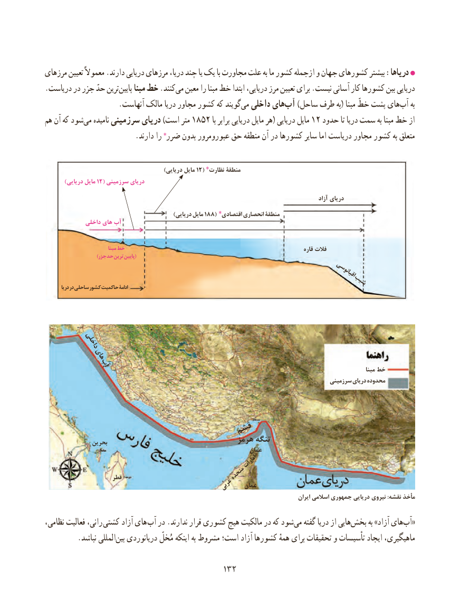

# PDF page 140

مرزهای تعیین معموالً .دارند دریایی مرزهای دریا، چند یا یک با مجاورت علت به ما کشور ازجمله و جهان کشورهای بیشتر :دریاها
.دریاست در جزر حدّ ترین‌پایین مبنا خط .کنندمی‌  معین را مبنا خط ابتدا دریایی، مرز تعیین برای .نیست آسانی کار کشورها بین دریایی
                    .آنهاست مالک دریا مجاور کشور که گویندمی‌  داخلی های‌آب )ساحل طرف به( مبنا خطّ پشت های‌آب به
هم آن که شودمی‌   نامیده سرزمینی دریای )است متر 1852 با برابر دریایی مایل هر( دریایی مایل 12 حدود تا دریا سمت به مبنا خط از
                        .دارند را ضرر٭ بدون عبورومرور حق منطقه آن در کشورها سایر اما دریاست مجاور کشور به متعلق

            )12(دریایی مایل    نظارت٭ منطقۀ
        )دریایی مایل 12( سرزمینی دریای
                                                                                                                   آزاد دریای
               )188(دریایی مایل     اقتصادی٭ انحصاری منطقۀ
             داخلی های آب

                              مبنا خط                                                                           قاره فالت
                         )جزر حد ترین پایین(
                                                                                              اقیانوسی                                                     شیب        دریا در ساحلی کشور حاکمیت ادامۀ

         داخلی
        های        آب                                                                                                                                        مبنا خط
                                                                                          سرزمینی دریای محدوده

                            قشم
               بحرین                                هرمز تنگه
                                                                 عمان
                                                            امارات
                      قطر                          متحده
                                       عربی   عمان
                                                                                                        ايران اسالمي جمهوري دريايي نيروي :نقشه مأخذ

،رانی،نظامی فعالیت          کشتی آزاد های  آب در .ندارند قرار کشوری هیچ مالکیت در که شود‌می گفته دریا از هایی‌بخش به »آزاد های ‌«آب
  .‌نباشد المللیبین دریانوردی مُخلّ اینکه به مشروط است؛ آزاد کشورها همهٔ برای تحقیقات و تأسیسات ایجاد ماهیگیری،

                                        132132

