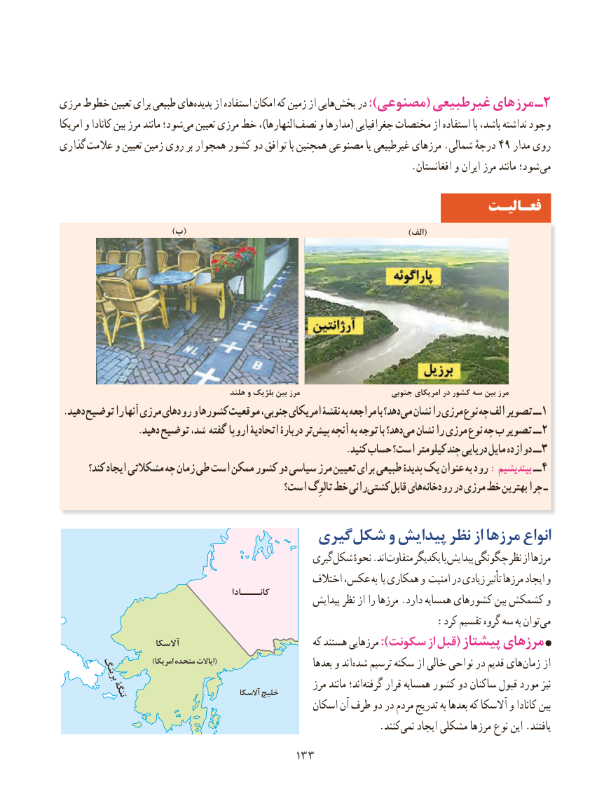

# PDF page 141

مرزی خطوط تعیین برای طبیعی هایپدیده‌     از استفاده امکان که زمین از هاییبخش‌    در ):مصنوعی( غیرطبیعی مرزهای ـ2
امریکا و کانادا بین مرز مانند شود؛می‌   تعیین مرزی خط ،)النهارهانصف‌    و مدارها( جغرافیایی مختصات از استفاده با باشد، نداشته وجود
گذاری عالمت و تعیین زمین روی بر همجوار کشور دو توافق با همچنین مصنوعی یا غیرطبیعی مرزهای .شمالی درجهٔ 49 مدار روی
     . افغانستان و ایران مرز مانند شود؛ می
                                                                 فعـالیـت
                                 )ب(                                                                 )الف(

                                            هلند و بلژیک بین مرز                      جنوبی امریکای در کشور سه بین مرز
 .دهید توضیح را آنها مرزی رودهای و کشورها موقعیت جنوبی، امریکای نقشۀ به مراجعه با دهد؟می‌  نشان را مرزی نوع چه الف تصویر ــ 1
                 .دهید توضیح شد، گفته اروپا اتحادیۀ دربارۀ تر پیش آنچه به توجه با دهد؟می‌  نشان را مرزی نوع چه ب تصویر ــ 2
                                                               .کنید حساب است؟ کیلومتر چند دریایی مایل دوازده ــ 3
       کند؟ ایجاد مشکالتی چه زمان طی است ممکن کشور دو سیاسی مرز تعیین برای طبیعی پدیدۀ یک عنوان به رود : بیندیشیم ــ 4
                                        است؟ تالوِگ خط رانی کشتی قابل هایرودخانه‌      در مرزی خط بهترین چرا ـ

                              گیریشکل‌    و پیدایش نظر از مرزها انواع
                                                  گیریشکل‌     نحوهٔ .اند متفاوت یکدیگر با پیدایش چگونگی نظر از مرزها
                                                    اختالف عکس، به یا همکاری و امنیت در زیادی تأثیر مرزها ایجاد و
                                              کانــــادا                                                        پیدایش نظر از را مرزها .دارد همسایه کشورهای بین کشمکش‌       و
       : کرد تقسیم گروه سه به توان می
                        آالسکا                               که هستند مرزهایی ):سکونت از قبل( پیشتاز مرزهای
                              )امریکا متحده ایاالت(                         بعدها و اندشده‌   ترسیم سکنه از خالی نواحی در قدیم هایزمان‌    از       برینگ
                                                         مرز مانند اند؛‌گرفته قرار همسایه کشور دو ساکنان قبول مورد نیز        تنگۀ                               آالسکا خلیج
                                                   اسکان آن طرف دو در مردم تدریج به بعدها که آالسکا و کانادا بین
                           .‌کنندنمی ایجاد مشکلی مرزها نوع این .یافتند
                                      133133

