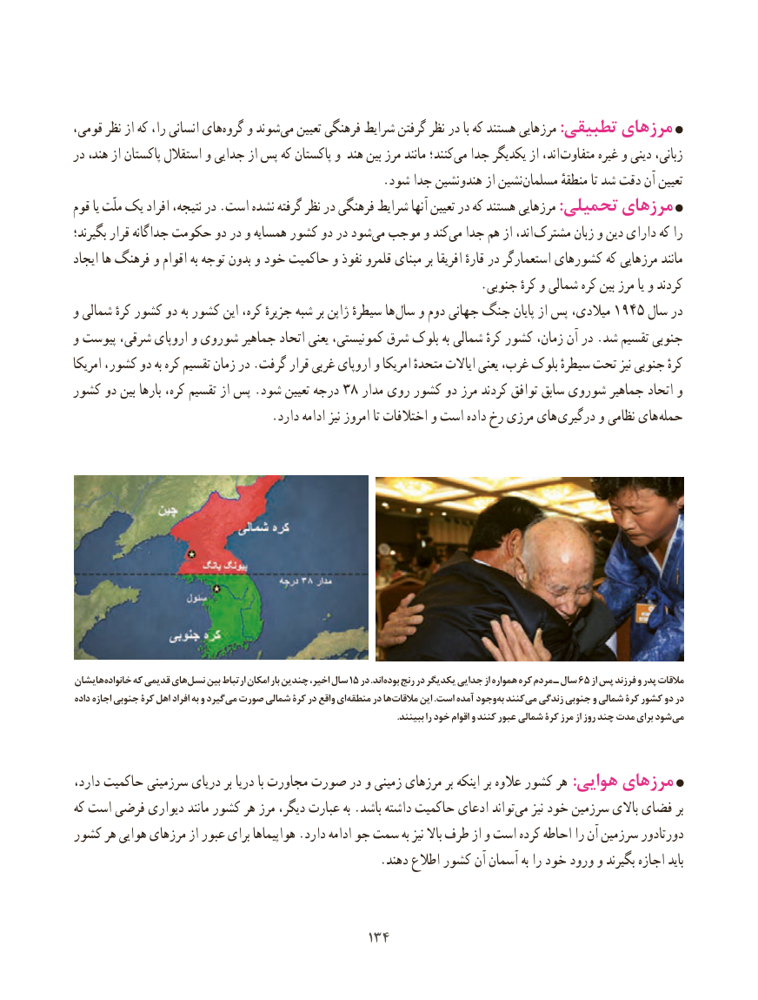

# PDF page 142

،هایقومی نظر از که را، انسانی       ‌گروه و شوندمی‌   تعیین فرهنگی شرایط گرفتن نظر در با که هستند مرزهایی :تطبیقی مرزهای
در هند، از پاکستان استقالل و جدایی از پس که پاکستان و هند بین مرز مانند کنند؛می‌  جدا یکدیگر از اند، متفاوت غیره و دینی زبانی،
    .‌شود جدا هندونشین از نشینمسلمان منطقهٔ تا شد دقت آن تعیین
قوم یا ملّت یک افراد نتیجه، در .است نشده گرفته نظر در فرهنگی شرایط آنها تعیین در که هستند مرزهایی :تحمیلی مرزهای
بگیرند؛ قرار جداگانه حکومت دو در و همسایه کشور دو در شود‌می موجب و کندمی‌  جدا هم از اند،  مشترک زبان و دین دارای که را
ایجاد ها فرهنگ و اقوام به توجه بدون و خود حاکمیت و نفوذ قلمرو مبنای بر افریقا قارهٔ در استعمارگر کشورهای که مرزهایی مانند
                                                                   .جنوبی کرهٔ و شمالی کره بین مرز یا و کردند
و شمالی کرهٔ کشور دو به کشور این کره، جزیرهٔ شبه بر ژاپن سیطرهٔ ها  سال و دوم جهانی جنگ پایان از پس میالدی، 1945 سال در
و پیوست شرقی، اروپای و شوروی جماهیر اتحاد یعنی کمونیستی، شرق بلوک به شمالی کرهٔ کشور زمان، آن در .شد تقسیم جنوبی
امریکا کشور، دو به کره تقسیم زمان در .گرفت قرار غربی اروپای و امریکا متحدهٔ ایاالت یعنی غرب، بلوک سیطرهٔ تحت نیز جنوبی کرهٔ
کشور دو بین بارها کره، تقسیم از پس .شود تعیین درجه 38 مدار روی کشور دو مرز کردند توافق سابق شوروی جماهیر اتحاد و
                                 .دارد ادامه نیز امروز تا اختالفات و است داده رخ مرزی های  درگیری و نظامی های  حمله

هایشان خانواده که قدیمی های نسل بین ارتباط امکان بار چندین اخیر، سال 15 در .اند بوده رنج در یکدیگر جدایی از همواره کره مردم ـ سال 65 از پس فرزند و پدر مالقات
داده اجازه جنوبی کرۀ اهل افراد به و گیرد می صورت شمالی کرۀ در واقع ای منطقه در ها مالقات این .است آمده وجود به کنند می زندگی جنوبی و شمالی کرۀ کشور دو در
  . ببینند را خود اقوام و کنند عبور شمالی کرۀ مرز از روز چند مدت برای شودمی

دارد، حاکمیت سرزمینی دریای بر دریا با مجاورت صورت در و زمینی مرزهای بر اینکه بر عالوه کشور هر :هوایی مرزهای
که است فرضی دیواری مانند کشور هر مرز دیگر، عبارت به .باشد داشته حاکمیت ادعای تواند‌می نیز خود سرزمین باالی فضای بر
کشور هر هوایی مرزهای از عبور برای هواپیماها .دارد ادامه جو سمت به نیز باال طرف از و است کرده احاطه را آن سرزمین دورتادور
                                                   .دهند اطالع کشور آن آسمان به را خود ورود و بگیرند اجازه باید

                                        134134

