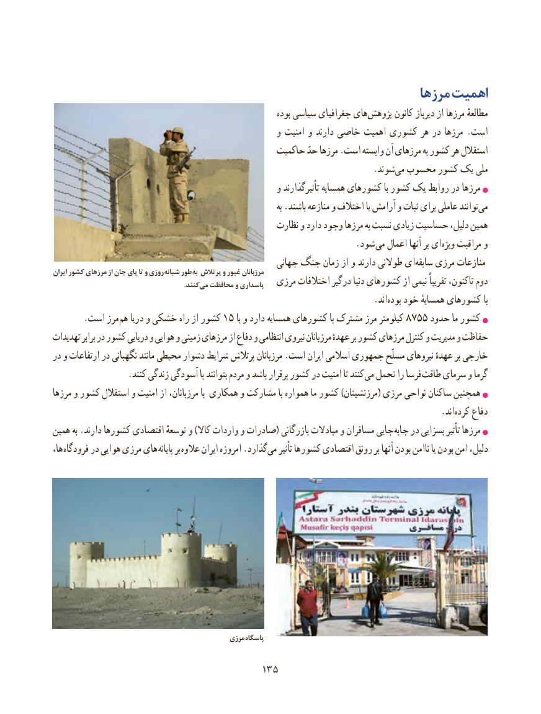

# PDF page 143

مرزها اهمیت
                                                                 بوده سیاسی جغرافیای هایپژوهش‌       کانون دیرباز از مرزها مطالعهٔ
                                                    و امنیت و دارند خاصی اهمیت کشوری هر در مرزها . است
                                               حاکمیت حدّ مرزها .است وابسته آن مرزهای به کشور هر استقالل
                           .‌شوند می محسوب کشور یک ملی
                                                    و تأثیرگذارند همسایه کشورهای با کشور یک روابط در مرزها
                                                                                   به .باشند منازعه و اختالف یا آرامش و ثبات برای عاملی توانند‌می
                                                   نظارت و دارد وجود مرزها به نسبت زیادی حساسیت دلیل، همین
                            . شود می اعمال آنها بر ایویژه‌   مراقبت و
                                                    جهانی جنگ زمان از و دارند طوالنی ای ‌سابقه مرزی منازعاتایران کشور مرزهای از جان پای تا و روزی شبانه طور به پرتالش و غیور مرزبانان
               .‌کنندمی محافظت و پاسداری   مرزی اختالفات درگیر دنیا کشورهای از نیمی تقریباً تاکنون، دوم
                                                                          .اند ‌بوده خود همسایهٔ کشورهای با
       .است مرز هم دریا و خشکی راه از کشور 15 با و دارد همسایه کشورهای با مشترک مرز کیلومتر 8755 حدود ما کشور
تهدیدات برابر در کشور دریایی و هوایی و زمینی مرزهای از دفاع و انتظامی نیروی مرزبانان عهدهٔ بر کشور مرزهای کنترل و مدیریت و حفاظت
در و ارتفاعات در نگهبانی مانند محیطی دشوار شرایط پرتالش مرزبانان .است ایران اسالمی جمهوری مسلّح نیروهای عهدهٔ بر خارجی
 . کنند زندگی آسودگی با بتوانند مردم و باشد برقرار کشور در امنیت تا کنند می تحمل را فرسا طاقت سرمای و گرما
مرزها و کشور استقالل و امنیت از مرزبانان، با همکاری و مشارکت با همواره ما کشور )مرزنشینان( مرزی نواحی ساکنان همچنین
                                                                                          .اند ‌کرده دفاع
همین به .دارند کشورها اقتصادی توسعهٔ و )کاال واردات و صادرات( بازرگانی مبادالت و مسافران جایی  جابه در بسزایی‌تأثیر مرزها
،ها فرودگاه در هوایی مرزی های پایانه بر عالوه ایران امروزه .گذاردمی‌   تأثیر کشورها اقتصادی رونق بر آنها بودن ناامن یا بودن امن دلیل،

                                               مرزی پاسگاه

                                       135135

