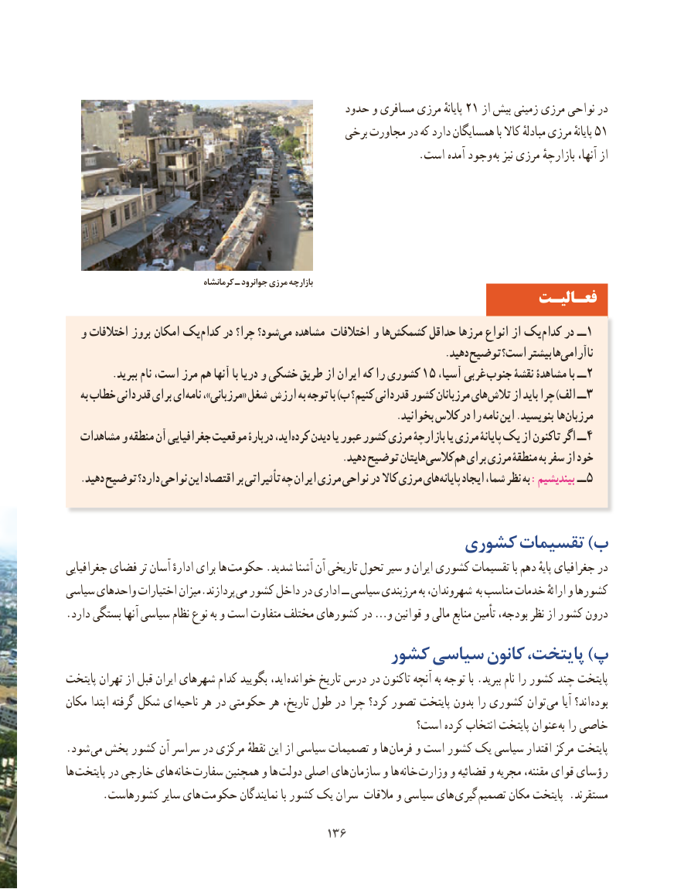

# PDF page 144

حدود و مسافری مرزی پایانهٔ 21 از بیش زمینی مرزی نواحی در
                                                  برخی مجاورت در که دارد همسایگان با کاال مبادلهٔ مرزی پایانهٔ 51
                                                                 .است آمده وجود  به نیز مرزی بازارچهٔ آنها، از              مرزی بازارچه تصویر

                                    کرمانشاه ـ جوانرود مرزی بازارچه
                                                                 فعـالیـت
  و اختالفات بروز امکان یک کدام در چرا؟ شود؟می‌   مشاهده اختالفات و هاکشمکش‌       حداقل مرزها انواع از یک کدام در ــ 1
                                                                            .دهید توضیح است؟ بیشتر هاناآرامی‌
.15ببرید نام است، مرز هم آنها با دریا و خشکی طریق از ایران که را کشوری  ،غربیآسیا          جنوب نقشۀ مشاهدۀ با ــ2
    به خطاب قدردانی برای ای نامه ،»مرزبانی« شغل ارزش به توجه با )ب کنیم؟ قدردانی کشور مرزبانان های تالش از باید چرا )الف ــ 3
                                                                  .بخوانید کالس در را نامه این .بنویسید ها مرزبان
   مشاهدات و منطقه آن جغرافیایی موقعیت دربارۀ اید،کرده‌   دیدن یا عبور کشور مرزی بازارچۀ یا مرزی پایانۀ یک از تاکنون اگر ــ 4
                                                       .دهید توضیح هایتانکالسی‌          هم برای مرزی منطقۀ به سفر از خود
.‌دهید توضیح دارد؟ نواحی این اقتصاد بر تأثیراتی چه ایران مرزی نواحی در کاال مرزی هایپایانه ایجاد شما، نظر به :بیندیشیم ــ 5

                                      کشوری تقسیمات )ب
جغرافیایی فضای تر آسان ادارهٔ برای ها  حکومت .شدید آشنا آن تاریخی تحول سیر و ایران کشوری تقسیمات با دهم پایهٔ جغرافیای در
سیاسی واحدهای اختیارات میزان.پردازند می کشور داخل در اداری ــ سیاسی مرزبندی به شهروندان، به مناسب خدمات ارائهٔ و کشورها
.دارد بستگی آنها سیاسی نظام نوع به و است متفاوت مختلف کشورهای در …و قوانین و مالی منابع تأمین بودجه، نظر از کشور درون
                                 کشور سیاسی کانون پایتخت، )پ
پایتخت تهران از قبل ایران شهرهای کدام بگویید اید، خوانده تاریخ درس در تاکنون آنچه به توجه با .ببرید نام را کشور چند پایتخت
مکان ابتدا گرفته شکل ای ناحیه هر در حکومتی هر تاریخ، طول در چرا کرد؟ تصور پایتخت بدون را کشوری توان می آیا اند؟ بوده
                                                        است؟ کرده انتخاب پایتخت عنوان  به را خاصی
.شود می پخش کشور آن سراسر در مرکزی نقطهٔ این از سیاسی تصمیمات و ها  فرمان و است کشور یک سیاسی اقتدار مرکز  پایتخت
ها پایتخت در خارجی های  خانه سفارت همچنین و ها دولت اصلی های سازمان و ها خانه  وزارت و قضائیه و مجریه مقننه، قوای رؤسای
 . کشورهاست سایر های حکومت نمایندگان با کشور یک سران مالقات و سیاسی های  گیری تصمیم مکان پایتخت .مستقرند

                                        136136

