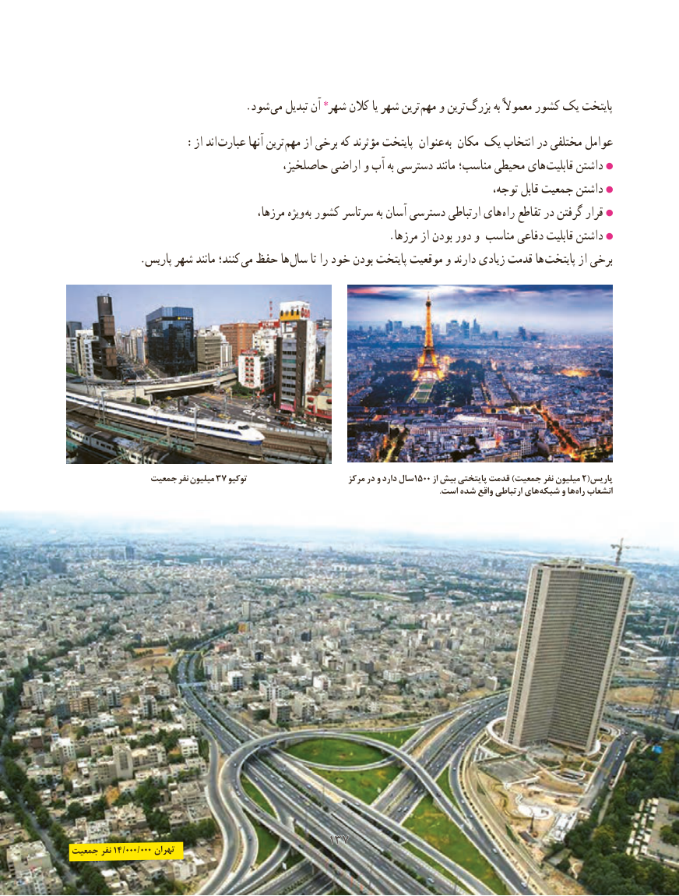

# PDF page 145

.شود می تبدیل آن شهر٭ کالن یا شهر ترین مهم و ترین بزرگ به معموالً کشور یک پایتخت
       : از اند عبارت آنها ترین مهم از برخی که مؤثرند پایتخت عنوان به مکان یک انتخاب در مختلفی عوامل
                                     حاصلخیز، اراضی و آب به دسترسی مانند مناسب؛ محیطی های قابلیت داشتن
                                                                                                    ،توجه قابل جمعیت داشتن
                    ،ویژهمرزها        به کشور سرتاسر به آسان دسترسی ارتباطی های راه تقاطع در گرفتن قرار
                                                          .مرزها از بودن دور و مناسب دفاعی قابلیت داشتن
             .پاریس شهر مانند کنند؛ می حفظ ها سال تا را خود بودن پایتخت موقعیت و دارند زیادی قدمت ها پایتخت از برخی

               جمعیت نفر میلیون 37 توکیو                        مرکز در و دارد سال 1500 از بیش پایتختی قدمت )جمعیت نفر میلیون 2(پاریس
       . است شده واقع ارتباطی های شبکه و ها راه انشعاب

                                      137137جمعیت نفر 14/000/000 تهران

